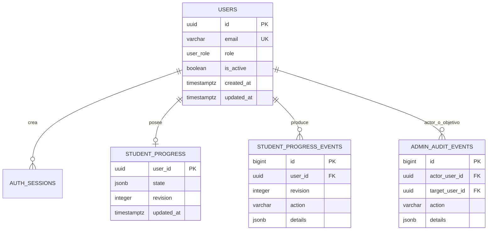

# QAPath Academy 5.0 — Administración y trazabilidad

## Objetivo

El rol `ADMIN` administra cuentas de **estudiantes**: altas, búsqueda paginada,
edición de correo, activación/desactivación y consulta de sus avances. La página
`/admin` y los endpoints `/api/v1/admin/*` requieren sesión activa y RBAC en la API.
No se permite promover roles desde HTTP ni editar administradores mediante la UI.

## Instalación / migración sobre v4

Conserva tu actual `apps/api/.env`, `apps/web/.env.local` y **base de datos**. No
reemplaces archivos de entorno por otros con contraseñas de ejemplo.

```powershell
pnpm.cmd install
pnpm.cmd db:migrate
pnpm.cmd build:libs
pnpm.cmd dev
```

La migración `003_administration_audit.sql` es **aditiva**, no destruye datos de
`001` y `002`. Las migraciones tienen checksums; nunca modifiques una aplicada.
Los progresos anteriores permanecen en `student_progress`, pero el historial
de `student_progress_events` comienza **a partir de la versión 5.0**.

## Crear cuenta ADMIN de manera segura

No existe cuenta/contraseña predeterminada ni endpoint público para asignar `ADMIN`.
El primer administrador debe aprovisionarse **localmente** mediante la consola y
un usuario de BD con permisos de escritura:

```powershell
pnpm.cmd db:create-admin
```

Introduce el correo y una contraseña de 12 a 128 caracteres cuando lo solicite.
La contraseña no aparece en pantalla ni se guarda en archivos. El comando
rechaza cuentas preexistentes: nunca convierte silenciosamente un estudiante
en administrador. Inicia sesión en `http://localhost:3000/login`; se abrirá `/admin`.

En entornos no interactivos se permiten variables de entorno efímeras
`ADMIN_EMAIL` y `ADMIN_PASSWORD`, pero evita escribir secretos en historial,
logs o archivos versionados. Para producción se recomienda una cuenta de
administración con MFA/SSO (aún no implementados).

## Endpoints (requieren rol ADMIN)

| Método | Ruta | Efecto |
|---|---|---|
| GET | `/api/v1/admin/summary` | Contadores de cuentas y promedio académico |
| GET | `/api/v1/admin/students?search=&status=all&page=1&limit=15` | Listado paginado |
| POST | `/api/v1/admin/students` | Crear estudiante (correo y contraseña) |
| GET | `/api/v1/admin/students/:id` | Datos y avance actual |
| PATCH | `/api/v1/admin/students/:id` | Cambiar `email` y/o `isActive` |
| GET | `/api/v1/admin/students/:id/events` | 50 eventos académicos recientes |
| GET | `/api/v1/admin/audit?studentId=&page=1` | Auditoría administrativa paginada |

Las cuentas inactivas **no pueden iniciar sesión**. Al desactivarlas se
revocan sus sesiones actuales en la misma transacción del cambio de estado.
No se realiza borrado físico de cuentas, para preservar la trazabilidad.

## Tablas y relaciones

- `users`: identidad, `role`, `is_active`, `created_at`, `updated_at`.
- `auth_sessions`: sesiones, expiración y revocación; token cifrado **no**:
  solo su hash SHA-256, que no debe salir del backend.
- `student_progress`: estado actual JSONB por `user_id`, revisión y fecha.
- `student_progress_events`: historial inmutable de operaciones académicas,
  `user_id`, revisión, acción, metadata mínima y fecha. No guarda texto de notas.
- `admin_audit_events`: actor, objetivo, acción, cambios y fecha.
- `vw_student_completed_weeks`: relación consultable de cada semana finalizada.
- `vw_student_quiz_scores`: vista consultable de puntajes por módulo.
- `vw_student_progress_summary`: vista SQL con un estudiante por fila, avance
  calculado sobre las 24 semanas y última actualización.
- `courses`, `lessons`, `learning_progress`: tablas heredadas de preparación;
  **el progreso activo de la web** utiliza `student_progress`. No mezclar ambas
  fuentes hasta implementar persistencia normalizada del catálogo.
- `qapath_schema_migrations`: migraciones aplicadas y checksum.

Ejemplos listos para pgAdmin: [`docs/sql/consultas_admin.sql`](sql/consultas_admin.sql).
Usa un usuario de BD con permisos `SELECT` sobre las vistas/tablas para
analítica; no conectes a PostgreSQL directamente desde el navegador.

## Reglas de seguridad y privacidad

- El backend valida sesión y rol; ocultar botones en React no constituye autorización.
- El registro público sigue creando exclusivamente `STUDENT`.
- El administrador no puede editar otro ADMIN ni INSTRUCTOR desde estos endpoints.
- Los eventos de progreso nunca contienen las notas privadas ni contraseñas.
- PostgreSQL guarda las mutaciones y su evento en la **misma transacción**.
- Los datos personales y logs requieren política de retención, acceso mínimo,
  protección de copias y tratamiento conforme a normativa aplicable.
- **Antes de producción:** MFA, verificación y recuperación de correo, rotación
  obligatoria de contraseñas iniciales, protección distribuida contra abuso,
  respaldos y cifrado administrado, observabilidad, pruebas de carga y seguridad.

## Verificar paso a paso (QA)

1. Ejecuta migraciones, crea Admin e inicia sesión.
2. Entra en `/admin`, crea un estudiante y búscalo por correo.
3. Inicia sesión como ese estudiante en otro navegador y completa semana 1.
4. Comprueba el 4% de avance, el evento `TOGGLE` y la nueva revisión.
5. Desactiva la cuenta desde Admin; comprueba que su sesión y un nuevo login son rechazados.
6. Reactívala y verifica que el avance anterior se conserva.
7. Consulta `vw_student_progress_summary`, `student_progress_events`
   y `admin_audit_events` con los ejemplos SQL.

Para controles generales: `pnpm.cmd check`; para E2E: `pnpm.cmd test:e2e`.

## Modelo de relaciones



La tabla `student_progress` es el estado actual y la tabla
`student_progress_events` constituye el **historial de operaciones**. Un
historial de operaciones no equivale a un historial de estados completos: para
analizar una curva exacta de porcentaje a lo largo del tiempo hay que
proyectar eventos, considerando la semántica de alternancia de semanas.
