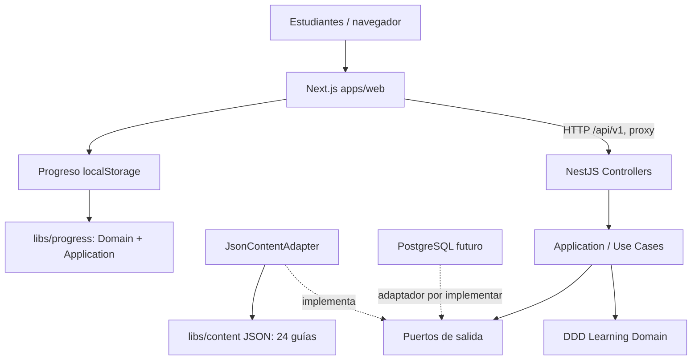
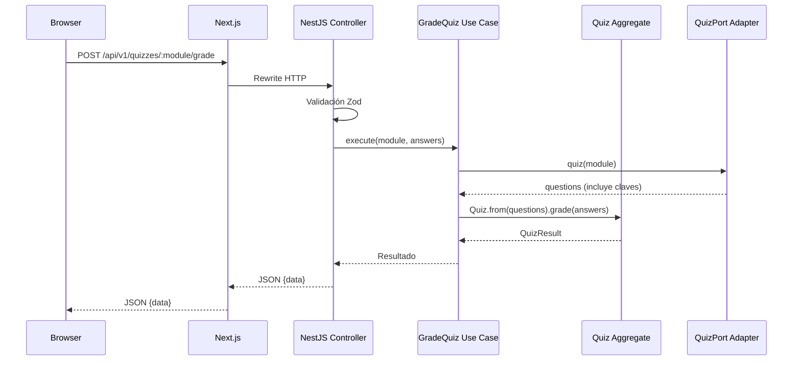

# QAPath Academy 3.0 — Clean Architecture + Hexagonal + DDD

## Contexto y decisión

Basado en `QAPath_Academy_Arquitectura_Vercel(1).md` aportado para el proyecto. La arquitectura y la infraestructura son decisiones distintas. Se adopta un **monorepo pnpm con dos aplicaciones independientes** (`apps/web` Next.js y `apps/api` NestJS) y paquetes reutilizables, desplegables por separado en Vercel. El backend es un **monolito modular**, no microservicios prematuros.

## Vista general

## Límites y dependencias

- **Domain (`libs/learning/src/domain`)**: aggregate `Quiz`, value object `WeekNumber`, errores de negocio, entidades y contratos de salida. No depende de frameworks.
- **Application (`libs/learning/src/application`)**: casos de uso `ListModules`, `GetModule`, `GetLesson`, `GetScrum`, `GradeQuiz`; recibe interfaces y orquesta reglas de negocio.
- **Hexagonal — puertos de salida**: `ModuleCatalogPort`, `ModuleDetailPort`, `LessonPort`, `ScrumPort`, `QuizPort`. Se usa ISP: cada caso requiere su interfaz mínima.
- **Hexagonal — adaptadores de entrada**: controladores HTTP NestJS; adaptador web Next.js `academy-api.ts`, sin acceso directo al dominio servidor.
- **Hexagonal — adaptadores de salida**: `JsonContentAdapter` para JSON. Un adaptador PostgreSQL puede añadirse sin modificar los casos de uso.
- **DDD — Bounded Contexts**: `learning` (contenido didáctico y evaluaciones), `progress` (avance académico local), `identity` (modelo futuro de usuarios). `content` es una librería de datos, no el modelo del dominio.
- **Contratos HTTP**: `packages/contracts` separa el shape serializado y validación Zod del dominio.
- **Infrastructure PostgreSQL**: `packages/database` implementa esquema Drizzle y factory de conexiones; NO se utiliza aún en procesos públicos.
- **Composition Root**: `apps/api/src/app.module.ts` hace la inyección de dependencias. La aplicación no conoce NestJS.

## Flujo de una Historia de Usuario

## Principios SOLID

- **S**: cada caso de uso resuelve una operación de negocio; cada controller adapta HTTP.
- **O**: nuevos adaptadores (PostgreSQL, CMS) satisfacen los puertos existentes sin cambiar el dominio.
- **L**: fake y adapter JSON pueden sustituirse preservando el comportamiento esperado de sus puertos.
- **I**: se separan catálogos, detalle, lección, Scrum y quizzes por contratos finos.
- **D**: la aplicación depende de interfaces; solo la composición decide implementaciones concretas.

## Patrones de diseño

**Repository**, **Adapter**, **Dependency Injection**, **Aggregate Root** (`Quiz`), **Value Object** (`WeekNumber`, `EmailAddress`), **Use Case/Interactor**, **DTO** y **Composition Root**. No introducir patrones por ceremonia si no resuelven un problema real.

## Seguridad y límites de MVP

- Progreso se guarda en `localStorage`; no hay cuentas de usuarios funcionales, ni roles autoritativos, ni sesiones ni certificados válidos.
- Las respuestas correctas de quizzes se almacenan en el backend JSON. Se envían al estudiante después de corregir.
- Credenciales en variables de entorno, nunca `NEXT_PUBLIC_`; `DATABASE_URL` no se usa todavía.
- API `stateless`, lista para función Vercel con `src/main.ts`; sin cron persistente ni uploads a disco.
- En producción: migraciones revisadas, pool serverless, política CORS restrictiva, logs, rate limiting, auth y autorización antes de persistir progreso.

## Testabilidad y observabilidad

- Node test runner sobre librerías compiladas para validar Aggregate, VO y Use Cases; validación de contenido e import boundaries.
- Playwright E2E de navegación, APIs y progreso en `apps/web/tests/e2e`.
- API tiene `GET /api/v1/health`; logs se pueden enriquecer con request IDs sin tocar Domain.

## Arquitectura evolutiva

PostgreSQL y sus migraciones están **preparados pero no conectados** al progreso real. Al agregar auth, crear adaptadores de persistencia y migrar avances solo por usuario autenticado con consentimiento.

---

## Actualización v4 (23-10-2026)

Se incorporó Identity + sesiones + roles (RBAC) y Progress persistente mediante adaptadores Drizzle/PostgreSQL. Las dependencias permanecen orientadas al dominio, sin NestJS ni PostgreSQL en `libs/identity` o `libs/progress`. Consulta [Implementación Identity y PostgreSQL](IMPLEMENTACION_IDENTIDAD_POSTGRES.md). El despliegue ahora **requiere** `DATABASE_URL` y migraciones previas. No abrir registro público sin verificación de email, rate limit distribuido y política de privacidad.
