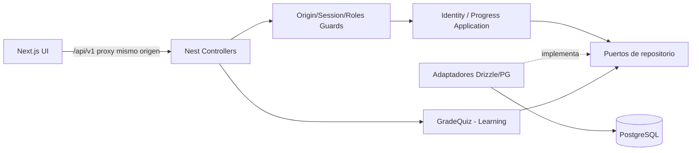

# QAPath Academy v4 — Identidad, autorización y progreso persistente

## Decisión arquitectónica

Tres bounded contexts: **Identity** (usuario, roles, credenciales y sesiones), **Learning** (catálogo y calificaciones) y **Progress** (avance versionado). Mantener interfaces/puertos en `libs`, implementaciones en `apps/api/src/infrastructure` y adaptador UI REST en `apps/web`.



## Contratos e invariantes

- `EmailAddress` normaliza dirección de correo; el registro público impone `role = STUDENT`.
- `AuthenticationService` orquesta alta, verificación de credenciales, sesiones y logout contra **puertos** (`IdentityRepository`, `PasswordPort`, `SessionPort`, `TokenPort`).
- `PostgresIdentityAdapter` implementa persistencia; `CryptoAuthAdapter` implementa hash/verificación/token por Node crypto; no se importa ninguno desde el dominio.
- `SessionGuard` asegura 401 por ausencia de sesión; `RolesGuard` deniega 403 cuando no se cumple `@Roles('ADMIN')`; `OriginGuard` restringe operaciones con cookie a orígenes autorizados.
- `PostgresProgressAdapter` usa el ID **del servidor**, `INSERT ... ON CONFLICT DO NOTHING` + `SELECT ... FOR UPDATE` dentro de transacción para serializar mutaciones por usuario.
- El cliente **no puede** llamar `PATCH /me/progress` con `grade` ni `scrum-grade`; la ruta autenticada de quiz califica con `GradeQuiz` y persiste su resultado en el backend. El endpoint de importación acepta respaldos locales de autoevaluaciones y esas notas son **autodeclaradas, no oficiales**; nunca usar `state.quizzes` importado para otorgar certificados. Esto reduce la manipulación directa, pero **no es todavía una infraestructura de certificación inviolable**.
- Los datos de progreso del invitado permanecen en `localStorage` hasta importación voluntaria, nunca se importan silenciosamente.

## Modelo lógico

```text
users (id PK, email UNIQUE, password_hash, role, failed_attempts, locked_until)
  ├─ auth_sessions (id PK, user_id FK, token_hash UNIQUE, expires_at, revoked_at)
  └─ student_progress (user_id PK/FK, state JSONB, revision, updated_at)
```

Se mantienen las tablas existentes `courses`, `lessons`, `learning_progress` para compatibilidad futura. `student_progress` guarda el estado real usado por la UI actual; no hay sincronización bidireccional entre ambos modelos antiguos y nuevos.

### Seguridad de sesiones

- `scrypt-v1` con sal aleatoria de 16 bytes y clave de 32 bytes; `crypto.timingSafeEqual`.
- Token opaco aleatorio de 32 bytes: cookie **HttpOnly**, SameSite Lax, Secure en producción; solo SHA-256 en DB.
- Expira en 7 días o al cerrar sesión; se comprueba contra PostgreSQL en cada operación protegida.
- Máximo 5 intentos fallidos por cuenta activa un bloqueo de 15 minutos, **pero no sustituye un rate limit distribuido**.
- No se loguean contraseñas, hashes ni tokens. No guardar secretos en repositorio. Configurar HTTPS obligatorio en producción.
- API frontend mediante rewrite de Next.js: el navegador se comunica con el origen web; esto simplifica el envío de cookies sin exponer otro origen público.

## Migraciones

Las migraciones SQL en `packages/database/sql` son la fuente canónica:

1. `001_initial.sql`: tablas previas (`users`, `courses`, `lessons`, `learning_progress`).
2. `002_identity_and_progress.sql`: `password_hash`, bloqueos, `auth_sessions`, `student_progress`.

`pnpm db:migrate` ejecuta secuencialmente transacciones y registra checksums en `qapath_schema_migrations`. No volver a editar scripts SQL ya aplicados: crear `003_...sql` para la siguiente evolución. **No mezclar ejecuciones manuales de `001` con el runner sin hacer un baseline previo.** Si tienes un esquema V3 existente aplicado manualmente, debes marcar `001` como aplicada tras validarlo o crear una base limpia de desarrollo; el runner no detectará automáticamente instalaciones manuales.

Las cuentas preexistentes sin contraseña quedan deshabilitadas con un hash marcador; se requiere un flujo de restablecimiento validado antes de habilitar el login de cuentas legacy.

## Verificación funcional sugerida (criterios QA)

- CA01: registro válido crea rol STUDENT; rol ADMIN enviado en el body no se permite.
- CA02: login correcto crea cookie HttpOnly; contraseña incorrecta -> 401 genérico.
- CA03: estudiante no puede acceder al endpoint ADMIN -> 403.
- CA04: invitado no puede leer/escribir `/me/progress` -> 401.
- CA05: dos estudiantes mantienen progreso independiente después de cerrar sesión y volver a ingresar.
- CA06: una lectura marcada persiste tras recargar, cerrar y volver a entrar.
- CA07: una evaluación autenticada almacena el puntaje calculado en backend.
- CA08: una calificación arbitraria por `PATCH` falla con 400.
- CA09: cerrar sesión revoca el token y elimina la cookie.
- CA10: un `POST` con cookie desde un origen distinto es rechazado con 403.
- CA11: importación local requiere acción explícita y fusiona, no borra datos previos.
- CA12: dos operaciones concurrentes sobre el mismo usuario no pierden actualizaciones.

## Operación

- La aplicación NestJS ahora **requiere DATABASE_URL** y conexión PostgreSQL para identidad y progreso. El servidor no crea tablas automáticamente al arrancar.
- `apps/api/.env` es leído desde `main.ts` con `process.loadEnvFile`; la herramienta de migraciones también lo puede leer desde esa ruta. Usar `pnpm db:migrate` **antes** de `pnpm dev`.
- Es posible usar PostgreSQL local vía `docker compose up -d postgres` o un proveedor administrado. Para Vercel usar una URL TLS con pooler adecuado al proveedor.
- Mantener `WEB_ORIGIN` igual al origen del navegador (separar múltiples orígenes de desarrollo por comas); configurar el destino del rewrite `API_PROXY_TARGET` en Next.
- No conservar sesiones en memoria ni hacer trabajos prolongados dentro de Vercel Functions.
