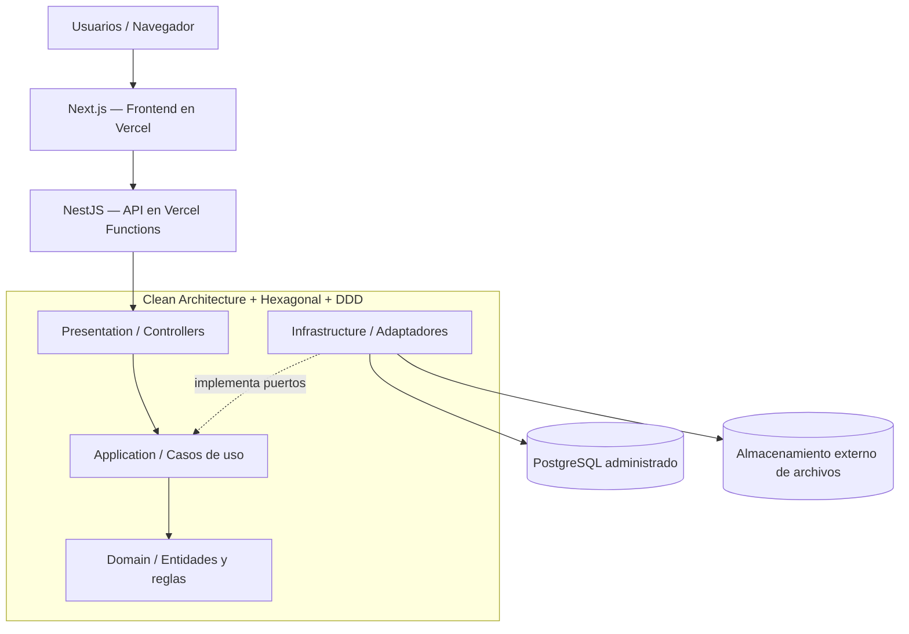

# QAPath Academy — Arquitectura y despliegue inicial en Vercel

## 1. Visión general

Sí, es posible desplegar **QAPath Academy** en **Vercel** utilizando **Clean Architecture + Arquitectura Hexagonal + Domain-Driven Design (DDD)** desde el inicio. Esta combinación permite lanzar una primera versión sin sacrificar buenas prácticas de diseño, mantenimiento y evolución del software.

> **Principio clave:** La arquitectura del software no determina por sí sola dónde debe desplegarse. Clean Architecture, Hexagonal y DDD definen la organización del código, los límites entre responsabilidades y las reglas de negocio; Vercel proporciona infraestructura de despliegue y ejecución.

## 2. Alternativas de despliegue

| Alternativa | Descripción | Cuándo elegirla |
|---|---|---|
| **A. Frontend y backend en Vercel** | Next.js en Vercel y NestJS desplegado mediante Vercel Functions. | Para iniciar con una solución sencilla, si la API se adapta a las limitaciones de ejecución serverless. |
| **B. Frontend en Vercel y backend independiente** | Next.js en Vercel y API NestJS desplegada en otra plataforma. | Cuando se requieran procesos persistentes, workers, conectividad específica o control más detallado de recursos y escalamiento. |

**Decisión inicial recomendada:** iniciar con la **alternativa A**, diseñando el backend de manera desacoplada para poder migrarlo posteriormente sin reescribir la lógica de negocio.

## 3. Arquitectura inicial propuesta

**Nombre:** QAPath Academy  
**URL propuesta:** `https://qapath-academy.vercel.app` *(sujeta a disponibilidad y configuración del proyecto)*.



### Componentes

| Componente | Tecnología | Responsabilidad |
|---|---|---|
| Frontend | **Next.js + TypeScript** | Interfaz de estudiantes, contenidos, autenticación y panel administrativo. |
| Backend | **NestJS + TypeScript** | API REST, validación, autorización y orquestación de casos de uso. |
| Domain | **DDD** | Entidades, objetos de valor, invariantes y reglas de negocio. |
| Application | **Clean Architecture** | Casos de uso y puertos de entrada/salida. |
| Infrastructure | **Arquitectura Hexagonal** | Adaptadores de base de datos, almacenamiento y servicios externos. |
| Presentation | **Controladores / DTOs** | Exponer las operaciones de negocio mediante contratos HTTP. |
| Base de datos | **PostgreSQL administrado** | Persistencia externa accesible desde la API desplegada. |

Vercel ofrece soporte para aplicaciones Next.js y para desplegar APIs NestJS como funciones. La viabilidad concreta depende de las características del backend y de los límites del plan seleccionado.

## 4. Consideraciones técnicas para Vercel

- **Backend stateless:** no depender de memoria local para mantener sesiones o estado persistente.
- **Conexiones a PostgreSQL:** utilizar un proveedor compatible con serverless y mecanismos de *pooling* o gestión de conexiones.
- **Almacenamiento de archivos:** guardar archivos persistentes en un servicio externo, no en el sistema de archivos efímero de las funciones.
- **Tareas asíncronas:** utilizar colas, servicios de jobs o infraestructura adicional; no asumir que una función puede ejecutar un worker permanente.
- **Límites operativos:** revisar duración máxima, memoria, concurrencia, tamaño de despliegue y costos de Vercel Functions según el plan.
- **Configuración:** proteger secretos con variables de entorno por ambiente y no incluir credenciales en el repositorio.
- **Observabilidad:** añadir logs estructurados, métricas y trazabilidad desde la primera versión.
- **Portabilidad:** evitar acoplar los casos de uso y el dominio a APIs específicas del proveedor de despliegue.

## 5. Plan de implementación

1. **Crear el repositorio** `qapath-academy` con TypeScript y **pnpm**, organizado como monorepo.
2. **Construir dos aplicaciones separadas:** `web` (Next.js) y `api` (NestJS).
3. **Definir los dominios iniciales:** usuarios, cursos, lecciones y progreso.
4. **Aplicar las reglas de arquitectura:** SOLID, DDD, casos de uso, puertos y adaptadores, con dependencias orientadas hacia el dominio.
5. **Configurar PostgreSQL:** esquema inicial, migraciones, conexiones y variables de entorno.
6. **Implementar calidad automatizada:** pruebas unitarias, integración, API, E2E con Playwright y pipelines con GitHub Actions.
7. **Conectar el repositorio a Vercel:** crear proyectos independientes para `web` y `api`, configurar directorios raíz, entornos y realizar despliegues de prueba.

## 6. Organización de despliegue recomendada

Un único repositorio con **dos proyectos independientes en Vercel**:

```text
qapath-academy/
├── apps/
│   ├── web/                  # Next.js (proyecto Vercel 1)
│   └── api/                  # NestJS (proyecto Vercel 2)
├── libs/
│   ├── identity/
│   ├── learning/
│   ├── content/
│   └── progress/
├── packages/
│   └── contracts/            # Contratos compartidos
├── tests/
│   ├── unit/
│   ├── integration/
│   ├── api/
│   └── e2e/
└── .github/workflows/       # CI/CD
```

Esta separación permite publicar frontend y API de manera independiente, controlar variables de entorno y facilitar una futura migración del backend a otra infraestructura.

## 7. Conclusión y decisión arquitectónica

**QAPath Academy puede iniciar completamente en Vercel con Clean Architecture + Hexagonal + DDD**, manteniendo límites claros entre negocio, aplicación e infraestructura.

La estrategia recomendada consiste en:

- **Empezar simple:** frontend Next.js y API NestJS desplegados en Vercel, con PostgreSQL administrado.
- **Conservar la independencia del dominio:** las reglas de negocio no deben depender ni de NestJS ni de Vercel.
- **Preparar la evolución:** si la plataforma crece, trasladar el backend o separar módulos sin reconstruir el núcleo del sistema.

**Decisión final:** usar **dos proyectos en Vercel (`web` y `api`) dentro del mismo monorepo** como punto de partida para la primera versión de QAPath Academy.

## Referencias

- [Vercel — Documentación oficial](https://vercel.com/docs)
- [Vercel — Functions](https://vercel.com/docs/functions)
- [Next.js — Documentación oficial](https://nextjs.org/docs)
- [NestJS — Documentación oficial](https://docs.nestjs.com/)
