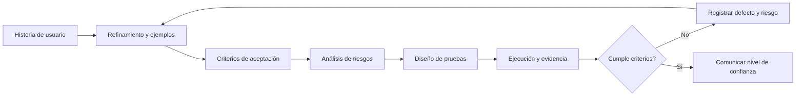
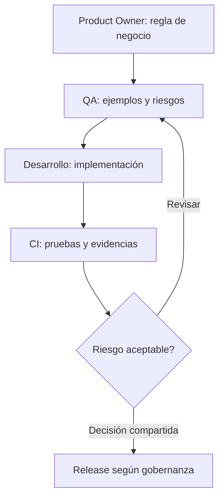

# SPEC-CONTENT-210 — Experiencia curricular interactiva y globos de procesos de QA (TO-BE)

> **Producto:** QAPath Academy · **Tipo:** Spec-Driven Development (SDD), contenido académico + UX/UI + accesibilidad  
> **Versión del SPEC:** 1.0.0 · **Fecha:** 2026-10-28  
> **Estado:** PROPUESTA PARA APROBACIÓN — **NO AUTORIZA CAMBIOS DE CÓDIGO NI DESPLIEGUES**  
> **Repositorio:** https://github.com/CristianHdez90/qapathAcademy · **Pantallas:** `/study/[week]` y, cuando corresponda, `/practice/[week]`  
> **Consolida:** los objetivos de `SPEC-CONTENT-200`, su plantilla de capítulos y `SPEC-UX-140` (globos), sin reemplazar automáticamente esos documentos ya aprobados. Es el contrato rector de esta mejora, sujeto a revisión de consistencia.  
> **Dependencia UX:** respetar `SPEC-UX-120` si su modo enfocado está aprobado; no implementar aquí una navegación global diferente.  
> **Fuente de verdad AS-IS:** código y pruebas del commit realmente presente en el workspace al ejecutar Codex; no asumir que GitHub y producción están sincronizados.

## 01. Intención

Elevar la calidad pedagógica y la interacción de **cada capítulo de los ocho módulos de QAPath Academy**, de modo que estudiar QA sea claro, entretenido, riguroso y transferible al trabajo cotidiano de un equipo real de desarrollo.

La experiencia propuesta toma como **referencia de calidad didáctica**, sin copiar su identidad, contenido ni diseño, a plataformas de formación interactiva como Platzi y EDteam. Combina lectura amena, microlecciones, ejemplos laborales verificables, grafos y flujos de proceso, decisiones guiadas y retroalimentación explicativa.

En cada demostración visual **«Así se aplica»**, los nodos/estados permitirán conocer **las acciones ordenadas para alcanzar ese objetivo**, mediante un globo contextual que aparece por interacción deliberada (hover, foco de teclado, toque/clic) o al alcanzar una visibilidad estable durante el desplazamiento. La explicación estará disponible sin obligar al estudiante a mantener un movimiento o una animación.

### 1.1. Resultados de aprendizaje esperados

- **Comprender:** explicar el concepto en palabras propias y reconocer cuándo se aplica.
- **Relacionar:** conectar roles, requisitos, riesgos, técnicas, actividades, artefactos y decisiones mediante diagramas significativos.
- **Aplicar:** ejecutar una miniacción QA en una historia verosímil, con entrada, decisión, resultado esperado y evidencia.
- **Argumentar:** explicar por qué una técnica es adecuada, qué riesgos cubre y cuáles siguen abiertos.
- **Recordar y transferir:** cerrar cada capítulo con recuperación activa y una situación novedosa, no solo lectura pasiva.
- **Estudiar con autonomía:** consultar detalles bajo demanda, sin saturación visual ni pérdida de su avance previo.

### 1.2. No confundir los niveles de interacción

| Nivel | Ejemplo | Propósito |
|---|---|---|
| Módulo | Fundamentos del Testing | Agrupa competencias |
| Semana | Mentalidad QA y ciclo de vida | Secuencia de estudio |
| Capítulo | QA, QC y testing | Unidad editorial |
| Tarjeta/concepto | Control de calidad (QC) | Un foco de aprendizaje |
| Demostración | Recibir → Comparar → Registrar | Flujo visual asociado al concepto |
| Nodo/estado | Comparar con criterios | Una etapa del flujo |
| Globo del nodo | Acciones, responsable y evidencia | Instrucción práctica contextual |

La navegación **entre tarjetas o capítulos** y la navegación **entre nodos del flujo** son funcionalidades distintas. Los globos no equivalen a nuevos capítulos ni a nuevas actividades calificadas.

## 02. Comportamiento

### 2.1. Línea base AS-IS y alcance verificado

Al elaborar esta propuesta, la revisión de los archivos publicados muestra **8 módulos, 24 semanas, 24 guías, 74 capítulos (`sections`) y 266 conceptos** (incluidos conceptos de ejemplos guiados). Las cantidades se deben recalcular en el commit local antes de actuar.

| Elemento actual | Ruta real de referencia |
|---|---|
| Módulos, semanas y evaluación | `libs/content/src/data/catalog.json` |
| Capítulos, conceptos, ejemplos y demostraciones | `libs/content/src/data/study-guides.json` |
| Ejercicios y rúbricas | `libs/content/src/data/practical-exercises.json` |
| Tipos públicos de contenidos | `packages/contracts/src/index.ts` (`ReadingConcept`, `StudyGuide`) |
| Tipos de aprendizaje | `libs/learning/src/domain/models.ts` |
| Composición de tarjetas | `apps/web/src/components/academy/reading-concepts.tsx` |
| Animación «Así se aplica» | `apps/web/src/components/academy/concept-demonstration.tsx` y `.css` |
| Página y navegación académica | `apps/web/src/components/academy/lesson-study.tsx` |
| Paginación y URL con hash | `apps/web/src/features/progress/use-lesson-pagination.ts` |
| Registro de cobertura y tiempo de lectura | `apps/web/src/features/progress/use-reading-tracker.ts` |
| Pruebas de integridad académica | `tests/content.test.mjs`, `tests/reading-concepts.test.mjs` |
| Pruebas visuales/funcionales | `apps/web/tests/e2e/reading-concepts.spec.ts`, `apps/web/tests/e2e/learning-ux.spec.ts` |

**Diagnóstico concreto:** el componente de demostración recibe `steps: string[]` e `icons?: string[]` y dibuja tres estados con animación de unos seis segundos. **Hoy los títulos de los pasos no incluyen un desglose de acciones** para mostrar en globos; dicho contenido requiere trabajo editorial y un contrato opcional nuevo. No sustituir este vacío por texto inventado en el frontend.

### 2.2. Gobernanza: ejecutar primero documentación, después implementación aprobada

| Puerta | Trabajo | Resultado | Código permitido |
|---|---|---|---|
| G0 — Baseline | SHA, dependencias, inventario, evidencia de UX y tests | Informe AS-IS actualizado | No |
| G1 — Auditoría curricular | Contrastar los 74 capítulos y 266 conceptos con fuentes oficiales | Matriz de exactitud, obsolescencia, duplicidad y prioridad | No |
| G2 — Propuesta editorial | Redactar el piloto W01-C01 completo, con grafo y globos | Propuesta Markdown + rúbrica + riesgos | No |
| G3 — Aprobación | Revisar con responsable QA y producto | Acta explícita de alcance, piloto y criterios | No |
| G4 — Implementación piloto | Extender contrato opcional, JSON y UI solo del piloto | PR pequeño, pruebas, capturas, fallback | Sí, solo alcance aprobado |
| G5 — QA piloto | Validar precisión, aprendizaje, accesibilidad y regresión | Evidencias + defectos resueltos | Correcciones aprobadas |
| G6 — Lotes | Aplicar patrón por semanas/módulos | PRs trazables y revisables | Sí, lote aprobado |
| G7 — Liberación | Validar CI y preproducción; autorizar despliegue | Release notes, rollback y monitorización | Solo tras aprobación |

**Modo inicial obligatorio para Codex: `DOCUMENTATION_ONLY`.** Crear o editar únicamente Markdown dentro de `docs/specs/` hasta recibir aprobación explícita. No usar una aprobación del documento como autorización implícita para todos los 74 capítulos ni para desplegar.

### 2.3. Estructura editorial obligatoria por capítulo

Cada capítulo propuesto incluirá los siguientes bloques. Adaptar la cantidad de tarjetas a su complejidad sin rellenar artificialmente:

1. **Identidad:** ID estable `Wxx-Cyy`, módulo, semana, audiencia, prerrequisitos, objetivo observable, duración estimada y versión de fuentes.
2. **Gancho:** situación-problema de 2–4 frases que podría ocurrir en un sprint, incidente, PR, refinamiento, demo o release.
3. **Pregunta inicial:** «¿Qué harías como QA?» con alternativas razonables; mostrar consecuencias después de la elección.
4. **Explicación clara:** concepto en lenguaje conversacional y preciso, analogía útil cuando corresponda, ejemplo y contraejemplo; definir siglas antes de usarlas.
5. **Relación visual:** mapa conceptual, grafo de dependencias, árbol de decisiones, flujo BPMN simplificado o diagrama de secuencia según el objetivo; no usar diagramas por decoración.
6. **Caso realista continuo:** historia de un producto ficticio, actores, datos, reglas, fallos posibles, conversación del equipo y decisión QA justificada.
7. **«Así se aplica»:** proceso de etapas con **un globo de acciones por nodo** (ver §2.6–2.9), artefacto o evidencia por etapa.
8. **Microactividad:** elegir, ordenar, clasificar, corregir, interpretar una respuesta API, escribir caso o diagnosticar bug; retroalimentación por opción.
9. **Transferencia:** situación distinta para demostrar comprensión, sin repetir mecánicamente el ejemplo resuelto.
10. **Cierre:** síntesis breve, error frecuente, preguntas de autoevaluación y referencia oficial con versión y fecha de consulta.

**Regla de legibilidad:** una idea principal por tarjeta; títulos orientados a acciones; párrafos cortos y pausas visuales. **No imponer un tiempo máximo universal**: objetivos complejos requieren ejemplos suficientes. El docente decide según nivel de dificultad y evidencia de comprensión.

### 2.4. Caso narrativo conductor de los ocho módulos

Utilizar una empresa ficticia de e-commerce/servicios con un equipo Scrum y un problema que evoluciona. No presentar las prácticas ficticias como exigencias normativas universales. Cada módulo tendrá variaciones para evitar historias repetitivas.

| Módulo | Semanas | Contexto de equipo | Artefacto que produce el estudiante |
|---|---|---|---|
| 01. Fundamentos | 1–2 | Incidente en descuentos y un riesgo de cobro duplicado | Glosario, distinción QA/QC/testing, mapa de riesgos |
| 02. QA Manual | 3–6 | PO refina una HU, QA cuestiona ambigüedades y Dev implementa | Criterios, matriz, casos, bug, evidencia y propuesta de estrategia |
| 03. HTTP/API/SQL | 7–8 | Frontend, backend y datos muestran inconsistencias | Validación de request/response, DevTools, Postman, SQL |
| 04. JS/TS/Git | 9–12 | Equipo automatiza validaciones de datos y colabora en PR | Código tipado, manejo de errores, commits revisables |
| 05. Playwright | 13–16 | QA estabiliza escenarios UI frente a cambios de interfaz | Locators robustos, assertions, trace y cross-browser |
| 06. Framework/API | 17–20 | Suite crece: fixtures, datos, mocks y contratos | Framework mantenible, pruebas API/UI y decisiones de abstracción |
| 07. CI/CD | 21–22 | Pipeline falla por test inestable; el equipo investiga | Workflow, evidencia, análisis de flakiness y plan de mejora |
| 08. Proyecto final | 23–24 | Equipo prepara release, evalúa riesgo residual y comunica resultados | Suite integrada, informe técnico, README y portafolio |

Reutilizar el hilo narrativo **no implica cambiar los IDs de semanas, módulos o ejercicios actuales**. Los nuevos ejemplos se adaptarán a los objetivos de cada semana.

### 2.5. Grafo, relaciones y flujos didácticos

**Formatos de diseño:** Markdown + Mermaid editable, con texto alternativo equivalente. Para la interfaz web, decidir en G2 si se renderiza un grafo seguro desde datos estructurados o si se muestra una representación semántica estática; un bloque Mermaid en Markdown no implica que la aplicación web ya lo renderice.

Reglas:

- El grafo debe responder una pregunta: **¿qué depende de qué?, ¿qué decisión sigue?, ¿quién actúa?, ¿qué se verifica?**
- Nodos con nombres breves y relaciones etiquetadas cuando ayuden a interpretar.
- No mezclar decisiones, secuencias y conceptos sin una leyenda.
- Los grafos deben ser **navegables/legibles con teclado y lectores de pantalla**, mediante alternativa textual estructurada.
- Diseño responsive; en pantallas pequeñas, permitir zoom/control o representación vertical sin scroll horizontal de toda la página.
- No ejecutar HTML/JS arbitrario procedente de archivos de contenido; usar un conjunto permitido de esquemas y tipos de nodo.
- Los elementos gráficos son complementarios: ninguna regla crítica debe depender exclusivamente de colores o animación.

**Ejemplo A — Relaciones entre actividades QA:**



**Alternativa textual:** la historia se refina, genera criterios, se analizan riesgos, se diseñan y ejecutan pruebas; si se detectan incumplimientos, se registra un defecto y se vuelve a discutir, mientras que los resultados conformes sustentan una recomendación de calidad.

**Ejemplo B — Actividades de QA dentro de un equipo:**



Los diagramas son **ejemplos propuestos**, no representación de un proceso obligatorio en todos los equipos Scrum.

### 2.6. «Así se aplica»: un globo contextual por estado/nodo

Cada demostración conservará su secuencia visual, iconos y controles. **El globo estará cerrado inicialmente** y se abrirá para explicar las acciones del paso indicado. Solo uno visible por demostración y, cuando se superpongan varias demostraciones, como máximo uno abierto en el área de estudio.

**Contenido mínimo del globo:**

- `Paso x / n`: nombre exacto del estado mostrado en el grafo.
- **Objetivo del paso** en una frase breve.
- **Acciones concretas ordenadas**: preferiblemente 2–4, redactadas con verbo de acción y datos/contexto.
- **Roles que participan** (opcionales, nunca una obligación universal).
- **Entrada necesaria** y **evidencia/salida observable**.
- **Decisión o error frecuente** (opcional, cuando añada valor didáctico).

No llenar globos automáticamente con paráfrasis del título. Los contenidos deben estar en datos académicos revisables y ser coherentes con el concepto y el ejemplo de la tarjeta.

### 2.7. Disparadores y estados de interacción del globo

| Acción del estudiante | Resultado TO-BE | Regla de cierre/prioridad |
|---|---|---|
| Mouse o trackpad (`hover`) | Al situarse sobre nodo o etiqueta durante un breve intervalo (sugerido 150–250 ms), se abre su globo | Permanece mientras el puntero esté en nodo o globo; `Escape` cierra |
| Teclado (`focus`) | `Tab` enfoca un botón de nodo; se puede leer al obtener foco; `Enter`/`Espacio` alternan el detalle | `Escape` cierra sin perder foco; el enfoque nunca ejecuta una acción académica |
| Pantalla táctil (`tap`) | Un toque abre el paso; otro nodo cambia el globo; toque externo o mismo botón cierra | No depende de hover ni bloquea desplazamiento vertical |
| Scroll/gesto táctil de desplazamiento | Si la demostración es **significativamente visible** (objetivo inicial ≥60%) y el scroll se estabiliza (p. ej. ≥350 ms), puede mostrarse **una vez** el detalle del paso activo como invitación a explorar | No reaparecer en bucle, no interrumpir interacción manual ni abrir múltiples globos |
| Animación del proceso | Actualiza el resaltado de la etapa visual | Nunca impone la apertura continua automática de los globos |

**Prioridad:** toque/clic y foco intencional > hover > activación contextual por scroll. Si el estudiante selecciona un paso, las transiciones del flujo no reemplazan su globo mientras lo está leyendo.

**Reglas técnicas observables:**

1. Registrar visibilidad por `IntersectionObserver` en el contenedor, no listeners intensivos en cada pixel del scroll.
2. No abrir globos al realizar scroll rápido por varias tarjetas; una invitación por entrada a vista como máximo.
3. Si el estudiante está leyendo un globo, **pausar temporalmente** la animación; al cerrar, reanudar solo si estaba corriendo y **no** estaba pausada explícitamente.
4. Si otro globo se abre, el anterior se cierra; no perder selección ni foco.
5. Mantener las variantes `idle`, `playing`, `paused`, `done` y `reduced` equivalentes a la implementación actual.
6. Bajo `prefers-reduced-motion`, los pasos y detalles siguen disponibles con texto estático; no animación obligatoria.
7. Para globos de texto no interactivos, usar semántica tooltip apropiada. Si incluyen controles, utilizar **popover no modal accesible** en lugar de `role="tooltip"` con botones interactivos.
8. Cumplir **WCAG 2.2 AA 1.4.13**: globo descartable, alcanzable con el puntero y persistente hasta cierre intencional o pérdida válida de foco/hover; control por teclado y foco visible.
9. No usar `aria-live` para narrar cada cambio automático de animación; no enviar foco involuntariamente al desplazar la página.
10. En mobile, reposicionar el globo encima, debajo o en un panel contextual anclado para evitar recortes; nunca tapar el botón necesario para cerrarlo.

### 2.8. Contrato editorial y técnico unificado (propuesta retrocompatible)

**AS-IS confirmado:** `ReadingConcept.demonstration` contiene `steps: string[]` e `icons?: string[]`. **TO-BE propuesto**, solo después de aprobar G3:

```typescript
export type DemonstrationStepDetail = {
  goal: string;          // objetivo verificable del nodo
  actions: string[];     // 2–4 acciones en lenguaje imperativo
  input?: string;        // información o artefacto necesario
  evidence: string;      // resultado o evidencia verificable
  roles?: string[];      // participación posible, no roles obligatorios
  pitfall?: string;      // error frecuente, opcional
};

export type Demonstration = {
  steps: string[];                    // EXISTENTE: conservar orden/IDs
  icons?: string[];                   // EXISTENTE
  stepDetails?: DemonstrationStepDetail[]; // NUEVO: opcional
};
```

**Invariantes a probar:**

- `stepDetails` existe solo si tiene **igual longitud y orden** que `steps`.
- El índice 0 del arreglo de detalles describe el índice 0 del grafo; nunca inferir coincidencia por texto ambiguo.
- `goal`, `evidence` y `actions` no vacíos, con 2–4 acciones significativas (salvo justificación docente explícita documentada).
- Si el nodo no tiene detalle aprobado, la línea, su etiqueta, el icono y la reproducción funcionan como antes; **no globo vacío ni texto generado automáticamente**.
- Reutilizar la única fuente editorial `study-guides.json`, sincronizando el tipo compartido con `libs/learning/src/domain/models.ts` y `packages/contracts/src/index.ts` **sin alterar contratos previos**.
- Para grafos adicionales, proponer `diagram` como tipo editorial opcional, con validación de nodos/edges; no asumir que la aplicación ejecuta Markdown o Mermaid de forma nativa.
- Mantener los IDs de módulo, semana, concepto, anclas `#chapter-*`, claves de progreso y estados persistidos.
- La actualización de la descarga Markdown de la clase, para incluir acciones/evidencias, requerirá validación de retrocompatibilidad.

### 2.9. Piloto completo: W01-C01, concepto «Control de calidad (QC)»

**Historia ficticia:** una tienda en línea entrega una versión candidata con un cambio de descuentos. El Product Owner definió que el cupón reduce solo el subtotal y no el envío. QA recibe la versión y necesita aportar evidencia verificable, no prometer que el sistema está libre de defectos.

**Objetivo de aprendizaje:** diferenciar QA, QC y testing, y practicar el control de calidad sobre criterios verificables.

| Nodo | Globo: objetivo | Acciones concretas | Entrada | Evidencia |
|---|---|---|---|---|
| 1. Recibir producto | Delimitar qué se evalúa | Confirmar versión/ambiente; leer HU y criterios; revisar datos/prerrequisitos | Build, HU, criterios, datos | Versión, alcance y ambiente registrados |
| 2. Comparar con criterios | Confrontar comportamiento con lo acordado | Ejecutar casos; calcular esperado; comparar obtenido; registrar diferencias reproducibles | Matriz de casos, build y observaciones | Resultados por criterio, capturas/logs pertinentes |
| 3. Registrar conformidad | Comunicar qué cumple y qué riesgo queda | Consolidar aprobados/fallidos/no ejecutados; documentar defectos; comunicar recomendación y riesgos | Resultados y defectos | Informe de validación y riesgos residuales |

**Regla de equipo:** QA aporta evaluación y recomendación; la decisión final de liberar depende de los responsables y el proceso de la organización.

**Ejemplo de datos:** subtotal de COP 105.000, cupón de 10 % sobre subtotal y envío de COP 10.000; **total esperado COP 104.500**. Si el sistema aplica el descuento al envío también, se registra diferencia con evidencia. Los datos son ficticios.

**Ejemplo JSON editorial para el concepto QC** (no modificar producción aún):

```json
{
  "id": "qc",
  "demonstration": {
    "steps": ["Recibir producto", "Comparar con criterios", "Registrar conformidad"],
    "stepDetails": [
      {
        "goal": "Identificar el candidato y alcance que será evaluado",
        "actions": ["Confirma versión y ambiente", "Lee la HU y sus criterios de aceptación", "Prepara datos y dependencias de prueba"],
        "input": "Build, HU, criterios y datos ficticios",
        "evidence": "Versión y alcance registrados",
        "roles": ["QA", "Product Owner", "Desarrollo"]
      },
      {
        "goal": "Comprobar los criterios con datos observables",
        "actions": ["Ejecuta casos ligados a criterios", "Calcula el resultado esperado", "Compara con el resultado real", "Guarda diferencias reproducibles"],
        "input": "Casos, resultado esperado y build",
        "evidence": "Matriz de resultados y evidencias",
        "roles": ["QA", "Desarrollo"]
      },
      {
        "goal": "Comunicar conformidades y riesgos pendientes",
        "actions": ["Resume criterios cumplidos y pendientes", "Documenta defectos relevantes", "Comunica riesgos y recomienda una acción"],
        "input": "Resultados, defectos y riesgos",
        "evidence": "Reporte de validación",
        "roles": ["QA", "Product Owner", "Equipo de entrega"]
      }
    ]
  }
}
```

El piloto deberá acompañarse de un grafo, su equivalente textual, una pregunta de decisión, una actividad corta y una rúbrica. Ningún número, rol o escena propuesta será tratada como dato real de la empresa usuaria.

### 2.10. Plantilla obligatoria de propuesta por capítulo

Guardar cada propuesta como Markdown en `docs/specs/content/` con ID estable y estado:

```markdown
# WXX-CYY — Título del capítulo

> Módulo / semana / capítulo / commit / estado: PROPUESTO / fuente / revisión

## 01. Intención
- Competencia y resultado observable:
- Prerrequisitos y perfil del estudiante:

## 02. Comportamiento
### Gancho narrativo (situación del equipo)
### Pregunta inicial y opciones con razonamiento
### Conceptos, analogía y contraejemplo
### Grafo/diagrama Mermaid y alternativa textual
### «Así se aplica»: para cada nodo, objetivo + acciones + insumo + evidencia
### Actividad interactiva y feedback por elección
### Transferencia a situación diferente
### Cierre, error frecuente, glosario y fuentes versionadas

## 03. Restricciones
- Preservar IDs/contratos/progreso; no publicar antes de revisión.

## 04. No-Objetivos
- Qué no enseña ni cambia este capítulo.

## Criterios de aceptación y trazabilidad
| ID | Dado / Cuando / Entonces | Evidencia | Estado |
|---|---|---|---|

## Revisión editorial y aprobación
- QA técnico:
- Diseño instruccional:
- UX/accesibilidad:
- Aprobación implementación:
```

### 2.11. Estándares técnicos, precisión y fuentes

Al 2026-10-28 se identificaron los siguientes **marcos de referencia**. Las versiones se vuelven a verificar antes de redactar o aprobar cada lote, porque estándares, APIs y herramientas cambian:

| Marco | Referencia verificada | Uso didáctico y precauciones |
|---|---|---|
| ISTQB CTFL | CTFL v4.0; syllabus inglés v4.0.1 | Términos, niveles, técnicas, principios, riesgo, defectos; no decir que todo contenido es requisito de certificación |
| ISTQB CTAL-AT | Agile Tester avanzado v2.0 (2026) | Whole-team approach, shift-left, estrategia, example mapping, exploratorio y test smells; temas avanzados optativos sin imponerlos a principiantes |
| ISTQB CTAL-TAE | Test Automation Engineering v2.0 (2024) | Arquitectura, sostenibilidad, CI/CD, riesgos y selección de automatización; adaptar al nivel de los módulos 05–07 |
| ISO/IEC 25010 | Edición 2023 | Modelo de calidad de producto con nueve características; no reproducir capítulos completos protegidos por licencia |
| ISO/IEC/IEEE 29119-1 | Edición 2022 | Conceptos generales de testing, planes, estrategias, modelos, comunicación |
| OWASP ASVS | v5.0.0 estable | Requisitos verificables de seguridad web; adaptar por riesgo y tipo de aplicación |
| Playwright Test | Documentación oficial consultada al revisar cada tema | Locators por roles, auto-waiting, assertions, aislamiento, traces y CI; ejemplos deben corresponder a la versión instalada |
| WCAG | 2.2, objetivo AA | Contenido en hover/focus, teclado, contraste, foco, reflow y movimiento reducido |
| Scrum | Scrum Guide en su versión vigente al revisar cada capítulo | Contexto de colaboración, evitando atribuir responsabilidades que Scrum no prescribe |

**Gobernanza de fuentes:** cada capítulo deberá registrar URL primaria, versión, fecha de consulta, afirmación respaldada y estado `VERIFICADA`, `PENDIENTE` o `DESACTUALIZADA`. No citar capturas, blogs o contenido de IA como autoridad normativa cuando exista fuente primaria. No atribuir a ISTQB, ISO u OWASP consejos pedagógicos propios de la academia.

Referencias primarias:

- https://istqb.org/certifications/certified-tester-foundation-level-ctfl-v4-0/
- https://istqb.org/certifications/certified-tester-advanced-level-agile-tester-ctal-at/
- https://istqb.org/wp-content/uploads/2024/11/ISTQB_CTAL-TAE_Syllabus_v2.0.pdf
- https://www.iso.org/standard/78176.html
- https://www.iso.org/es/contents/data/standard/08/12/81291.html
- https://asvs.owasp.org/
- https://playwright.dev/docs/best-practices
- https://www.w3.org/TR/WCAG22/
- https://www.w3.org/WAI/WCAG22/Understanding/content-on-hover-or-focus.html

### 2.12. Calidad editorial y rúbrica (aplicación por capítulo)

Puntuar cada dimensión de 0 a 2; **mínimo 14/16 y ninguna dimensión crítica en 0** para proponer aprobación. No es métrica de aprobación de una certificación oficial:

| Dimensión | 0 | 1 | 2 |
|---|---|---|---|
| Exactitud técnica (crítica) | Error o sin respaldo | Parcialmente verificada | Correcta y verificable |
| Resultado de aprendizaje (crítica) | No observable | Parcial | Observable y evaluable |
| Caso de equipo real | Ausente | Genérico | Contexto, decisión y consecuencia |
| Legibilidad | Sobrecargado | Aceptable | Claro, progresivo y atractivo |
| Grafo significativo | Decorativo/incorrecto | Parcial | Relaciones correctas + alternativa |
| Acciones por estado | Vagas/ausentes | Incompletas | Acciones concretas y evidencia por nodo |
| Microinteracción | Pasiva/inexistente | Superficial | Decisión + feedback explicativo |
| Inclusión/accesibilidad (crítica) | Barrera crítica | Ajustes pendientes | Teclado, táctil y alternativas comprobadas |

### 2.13. Criterios de aceptación funcionales, editoriales y no funcionales

Los CA siguientes son **condiciones de aceptación**, no resultados de pruebas ya ejecutadas.

| ID | Criterio verificable |
|---|---|
| CA-01 | Cada capítulo propuesto declara objetivo observable, prerequisitos y referencias primarias versionadas. |
| CA-02 | La revisión identifica y clasifica información desactualizada, imprecisa o duplicada antes de cambiar contenido. |
| CA-03 | El piloto diferencia QA, QC y testing de modo técnicamente correcto, con un ejemplo y un contraejemplo. |
| CA-04 | El caso presenta al menos una interacción realista entre QA, PO/negocio y desarrollo, sin imponer una ceremonia o rol ficticio. |
| CA-05 | Existe un diagrama de relaciones/procesos y una alternativa textual que comunica toda la información esencial. |
| CA-06 | Una microactividad requiere tomar una decisión y proporciona explicación de las respuestas acertadas y erradas. |
| CA-07 | Los conceptos enriquecidos mantienen los títulos, identificadores y secuencia de nodos existentes, salvo cambio aprobado explícitamente. |
| CA-08 | El estado inicial de cada demostración no abre globos ni cubre la lectura. |
| CA-09 | Hover en cualquier nodo muestra **solo** su detalle, con acciones, insumo y evidencia coherentes. |
| CA-10 | El estudiante puede mover el mouse desde el nodo hacia el globo sin perder su contenido. |
| CA-11 | Los nodos son operables por `Tab`, `Enter`, `Espacio` y `Escape`, con foco visible y retorno predecible. |
| CA-12 | Un toque abre el globo, otro nodo lo reemplaza y tocar fuera lo cierra; el scroll móvil sigue funcionando. |
| CA-13 | El scroll estable ofrece detalle del nodo activo sin destellos, aperturas repetidas ni reemplazo de selección manual. |
| CA-14 | Abrir un globo pausa temporalmente la demostración sin cancelar la pausa que eligió expresamente el estudiante. |
| CA-15 | `prefers-reduced-motion` mantiene disponibles acciones y evidencias, sin necesidad de animación. |
| CA-16 | La presentación no produce overflow horizontal ni texto truncado en 320, 390, 768, 1280 y 1920 px. |
| CA-17 | El modo lector de pantalla puede acceder a todos los pasos sin anuncios automáticos invasivos. |
| CA-18 | Si un concepto no tiene `stepDetails`, el componente actual sigue funcionando sin globos vacíos ni errores. |
| CA-19 | Añadir `stepDetails` sin aprobación no cambia puntajes, progreso, notas, historial, revisión ni finalización de semana. |
| CA-20 | Los enlaces por hash, la paginación de lectura y la descarga Markdown conservan funcionalidad; la descarga incluye detalles nuevos solo cuando existan. |
| CA-21 | Las pruebas actuales de conceptos, E2E y aprendizaje siguen pasando sin eliminar ni debilitar sus aserciones. |
| CA-22 | El piloto pasa revisión editorial, accesibilidad y QA técnico antes de implementar otros conceptos. |
| CA-23 | Cada lote conserva trazabilidad entre fuente, concepto, grafo, estados, actividad, prueba y PR. |
| CA-24 | No hay modificación de backend, PostgreSQL, Firebase, MFA, RBAC o Vercel por la mera actualización editorial. |

**BDD mínimo del piloto:**

```gherkin
Característica: Explicación contextual del proceso de control de calidad
  Escenario: Consultar acciones del segundo estado con mouse
    Dado que estudio el concepto «Control de calidad (QC)»
    Y la demostración está visible sin globos abiertos
    Cuando mantengo el puntero sobre «Comparar con criterios»
    Entonces aparece el globo del paso 2 de 3
    Y se enumeran las acciones de comparación con el resultado esperado
    Y se presenta la evidencia «Matriz de resultados y evidencias»
    Y no aparece ningún globo de los otros pasos

  Escenario: Leer el paso con teclado
    Dado que enfoco el nodo «Registrar conformidad» con Tab
    Cuando activo el nodo con Enter
    Entonces puedo leer las acciones y evidencias con el teclado
    Y al presionar Escape el globo se cierra sin perder el foco

  Escenario: Los globos no alteran progreso
    Dado que el estudiante tiene un avance y notas persistentes
    Cuando abre y cierra los tres globos
    Entonces no se registra automáticamente ningún capítulo completado
    Y sus notas, calificaciones y avance permanecen idénticos
```

### 2.14. Pruebas, evidencias y Definition of Done

**Antes de G3 (solo documentación):** auditoría de fuentes y brechas, propuesta de capítulo W01-C01, grafo Mermaid + alternativa textual, tabla de globos QC, matriz de test, riesgo de regresión y prototipo de bajo nivel.

**Después de aprobación (piloto implementado):**

- Contrato nuevo opcional validado por pruebas de integridad editorial (longitud, orden, lenguaje y evidencia).
- Pruebas unitarias del mapeo nodo → detalle, fallback sin datos, prioridad de disparadores y pausa/reanudación.
- Playwright desktop: hover individual, foco y teclado, interacción entre globo y nodo, solo un globo, cierre con Escape.
- Playwright móvil: tap en 320/390 px, scroll natural, cierre al tocar afuera y pantalla con zoom.
- Playwright movimiento reducido; lectores de pantalla y revisión manual de WCAG 2.2 AA, no solo axe.
- Validación de exportación Markdown, navegación hash, tarjetas paginadas si el SPEC-UX-120 ya está implantado.
- Regresión obligatoria: `pnpm.cmd check`, `tests/reading-concepts.test.mjs`, `apps/web/tests/e2e/reading-concepts.spec.ts`, `apps/web/tests/e2e/learning-ux.spec.ts` y las pruebas académicas afectadas.
- Evidencias por resolución, reporte del resultado de pruebas, comparación antes/después y plan de rollback del cambio editorial y visual.
- **DoD:** 100 % de CA aplicables aprobados, cero fallos críticos conocidos, revisión de contenido firmada y autorización expresa de despliegue.

## 03. Restricciones

1. **No modificar el producto ahora.** La creación y lectura de este SPEC únicamente autorizan análisis y nuevos `.md` en `docs/specs/`. Código, JSON, CSS, tests, dependencias e infraestructura requieren aprobación explícita posterior.
2. **Preservar las funciones actuales:** navegación, tarjetas, notas, progreso, autoevaluaciones, ejercicios, descarga, animaciones, asistentes, autenticación, roles y auditoría.
3. **Mantener la arquitectura y contratos:** Clean/Hexagonal/DDD, API, datos persistidos y IDs públicos. Los cambios editoriales nunca pueden redefinir silenciosamente las reglas de dominio.
4. **No declarar progreso por interacción visual:** hover, scroll, focus, tap, apertura de globo o reproducción de un grafo **no** equivalen a evidencia de aprendizaje ni a completar una actividad.
5. **Alineación entre los tres SPEC de origen:** 200 define contenido, plantilla define unidad editorial, 140 define comportamiento visual. Este documento consolida ambos contratos; cualquier discrepancia se documenta como decisión pendiente, no se resuelve mediante cambios arbitrarios.
6. **Actualización verificada:** usar fuentes primarias y su versión, fecha y contexto; no citar versiones «últimas» sin verificarlas para cada lote.
7. **No copiar materiales protegidos** de Platzi, EDteam, ISTQB, ISO ni otras fuentes; crear historias, diagramas, actividades, gráficos y redacción originales.
8. **Accesibilidad como requisito funcional:** WCAG 2.2 AA como objetivo, contenido hoverable/dismissible/persistent, semántica correcta, teclado, touch, movimiento reducido, alternativa textual y contraste.
9. **Rendimiento:** nada de librerías gráficas pesadas o grandes recursos de red sin justificación, medición y aprobación; cargas diferidas donde corresponda.
10. **Datos seguros:** todos los casos usan usuarios ficticios; no exponer datos reales, credenciales, tokens o sistemas de terceros.
11. **Sin automatizaciones masivas ciegas:** primero capítulo y concepto QC piloto; luego lotes pequeños con revisión humana de precisión y utilidad.
12. **No degradar pruebas:** está prohibido borrar/desactivar tests o modificar los umbrales de aceptación para hacer pasar un cambio defectuoso.
13. **No autoabrir globos en ráfaga:** el estudiante conserva control; no solapar MariBug, menú, navegación o controles de la tarjeta.
14. **No prometer simulación real:** distinguir claramente ejemplos didácticos, simuladores y actividades verdaderamente conectadas a un servicio o API.
15. **No desplegar desde Codex sin autorización:** PR y CI no equivalen a permiso para promover cambios a Vercel.

## 04. No-Objetivos

- Reemplazar el producto por una copia visual o curricular de Platzi o EDteam.
- Crear una plataforma nueva, un CMS, una API o tablas PostgreSQL para guardar los textos de los globos.
- Reescribir de una sola vez las 24 guías, las 74 secciones y los 266 conceptos.
- Sustituir videos, documentos, cursos o normas oficiales con reproducciones no autorizadas.
- Cambiar módulos, objetivos acreditados, número de semanas, cuestionarios, criterios de finalización o historial del estudiante.
- Convertir todos los grafos en simulaciones técnicas complejas sin una necesidad pedagógica medible.
- Hacer obligatoria la interacción con globos para avanzar o aprobar un capítulo.
- Abrir automáticamente el globo de cada nodo al recorrer una animación.
- Implementar análisis de atención invasivos, seguimiento biométrico, grabaciones o telemetría personal nueva.
- Modernizar todo el diseño global o el sistema de navegación fuera de lo aprobado en SPEC-UX-120.

## 05. Entregables documentales y orden de ejecución

Crear **solo** en `docs/specs/` hasta G3:

1. `content/00-matriz-auditoria-curricular.md`: módulo, semana, capítulo, temas, estandar, estado de fuente, brecha, riesgo y evidencia.
2. `content/W01-C01-propuesta-capitulo.md`: capítulo completo con historia, grafo, alternativas textuales, acciones por nodo, actividad y rúbrica.
3. `content/00-contrato-grafos-y-globos.md`: JSON opcional, compatibilidad, estados, eventos, accesibilidad y fallback.
4. `content/00-plan-pruebas-contenido-y-ux.md`: matriz de CA y Playwright/unitarias existentes y nuevas.
5. `content/00-roadmap-por-modulos.md`: lotes, prioridades, propietarios, dependencias, revisión de estándares y rollback.
6. `content/00-decisiones-pendientes.md`: discrepancias de fuentes, riesgos no resueltos y decisiones que requieren aprobación.

### Orden recomendado de lotes (solo propuesta)

1. **Piloto W01-C01 / QC**: demostrar utilidad del nuevo contrato, precisión, acciones y accesibilidad.
2. **Resto semanas 1–2**: validar fundamentos y terminología ISTQB.
3. **Semanas 3–8**: QA manual, API y SQL.
4. **Semanas 9–16**: programación y Playwright con ejemplos ejecutables probados.
5. **Semanas 17–24**: framework, CI/CD, proyecto y portafolio.

Cada lote independiente exige revisión, pruebas, aprobación y opción de rollback.

## 06. Prompt para Codex / Claude Code / Cursor

> Actúa como Lead QA Engineer, diseñador instruccional y especialista en UX accesible. Lee `docs/specs/SPEC-CONTENT-210-consolidado-aprendizaje-interactivo-TO-BE.md` y contrasta sus afirmaciones con el código local de QAPath Academy. Ejecuta **G0–G2 únicamente**: identifica el commit, audita los 74 capítulos y 266 conceptos reales, revisa fuentes técnicas primarias vigentes y diseña W01-C01 con un caso de equipo de desarrollo, grafo Mermaid + alternativa textual, pregunta interactiva y globos completos del proceso QC. Documenta contrato opcional `stepDetails`, interacción por hover/focus/tap/scroll, reglas de accesibilidad, riesgos y pruebas. Crea documentos **solo en `docs/specs/content/`**. NO alteres código, JSON, pruebas, dependencias, configuración, datos ni Vercel. Presenta lo elaborado y solicita aprobación explícita antes de implementar.

## 07. Registro de aprobación

| Campo | Valor |
|---|---|
| Baseline Git SHA | `PENDIENTE: obtener al iniciar Codex` |
| Responsable técnico QA | Pendiente |
| Revisor pedagógico | Pendiente |
| Revisor UX/accesibilidad | Pendiente |
| Aprobación del piloto | **NO OTORGADA** |
| Aprobación de cambios productivos | **NO OTORGADA** |
| Fecha de autorización | Pendiente |
| PR / build / despliegue | Pendiente |

## 08. Inventario de capítulos cubiertos (AS-IS)

Los títulos siguientes provienen del catálogo de guías consultado para esta versión del SPEC. **Recapturar desde Git al comenzar Codex**, pues pueden cambiar antes de aplicar el TO-BE. Cada fila es una unidad de auditoría/editorial, no una orden de reescritura.

| Semana | Módulo | Capítulos de lectura actuales |
|---|---|---|
| 01 | Fundamentos | QA, QC y testing: conceptos diferentes · Cómo se relacionan SDLC y STLC · Los siete principios del testing |
| 02 | Fundamentos | Niveles de prueba · Tipos y objetivos de pruebas · Priorización basada en riesgos |
| 03 | QA Manual | Estructura de una historia de usuario · Criterios de aceptación comprobables · Revisión temprana y refinamiento |
| 04 | QA Manual | Partición de equivalencia · Análisis de valores límite · Tablas de decisión y transiciones |
| 05 | QA Manual | Anatomía de un buen caso de prueba · Ciclo de vida del defecto · Evidencias y trazabilidad |
| 06 | QA Manual | QA dentro de Scrum · Diseña una estrategia ligera · Métricas para decidir |
| 07 | HTTP/API/SQL | Piezas de una petición HTTP · Casos positivos y negativos de API · Validaciones automatizadas en Postman · Herramientas de desarrollo (DevTools) |
| 08 | HTTP/API/SQL | Consultas SQL esenciales · NULL y cardinalidad en relaciones · Agregaciones y comprobaciones SQL |
| 09 | JavaScript/TypeScript | Variables y datos · Condiciones y ciclos · Funciones pequeñas, fáciles de probar · Git como respaldo del trabajo QA |
| 10 | JavaScript/TypeScript | Objetos y arreglos · map, filter, find y reduce · JSON y operaciones seguras |
| 11 | JavaScript/TypeScript | ¿Qué añade TypeScript? · Interfaces, opcionales y nulabilidad · Generics y tipos reutilizables |
| 12 | JavaScript/TypeScript | Promesas y await · Manejo de fallos asíncronos · Clases y módulos para organizar el código |
| 13 | Playwright | Instalación y arquitectura básica · Estructura de una prueba y aserciones · Primer ciclo de depuración |
| 14 | Playwright | Locators basados en intención de usuario · Auto-waiting y reintentos automáticos · Locators estrictos y debugging |
| 15 | Playwright | Iframes, pestañas y formularios · Observabilidad de errores · Diseñar un E2E de valor |
| 16 | Playwright | playwright.config.ts · Cross-browser con sentido · Test isolation y retries |
| 17 | Framework/API | Qué resuelve Page Object Model · Principios de diseño aplicados · Cuándo considerar Screenplay |
| 18 | Framework/API | Concepto de fixture · Estado autenticado y datos · Setup, teardown y diseño de datos |
| 19 | Framework/API | APIRequestContext en Playwright · Separar contratos de comportamiento · API como herramienta de preparación de UI |
| 20 | Framework/API | Intercepción y mocking de red · Configuración por ambientes · Elegir abstracciones avanzadas |
| 21 | CI/CD | Conceptos de integración continua · Workflow para Playwright · Diagnóstico y seguridad en CI |
| 22 | CI/CD | Qué es un test flaky · Paralelización y sharding · Métricas que aportan valor |
| 23 | Proyecto final | Definir un alcance realizable · Matriz de trazabilidad · Diseñar una combinación UI + API |
| 24 | Portafolio | README reproducible · Presentar decisiones de calidad · Evaluación final del nivel QA Automation |

**Control de inventario:** 22 semanas con 3 capítulos y 2 semanas (07 y 09) con 4 capítulos: `22×3 + 2×4 = 74`.

**Fin del SPEC.** El documento describe una propuesta TO-BE; ninguna funcionalidad de QAPath Academy queda modificada por su creación.
