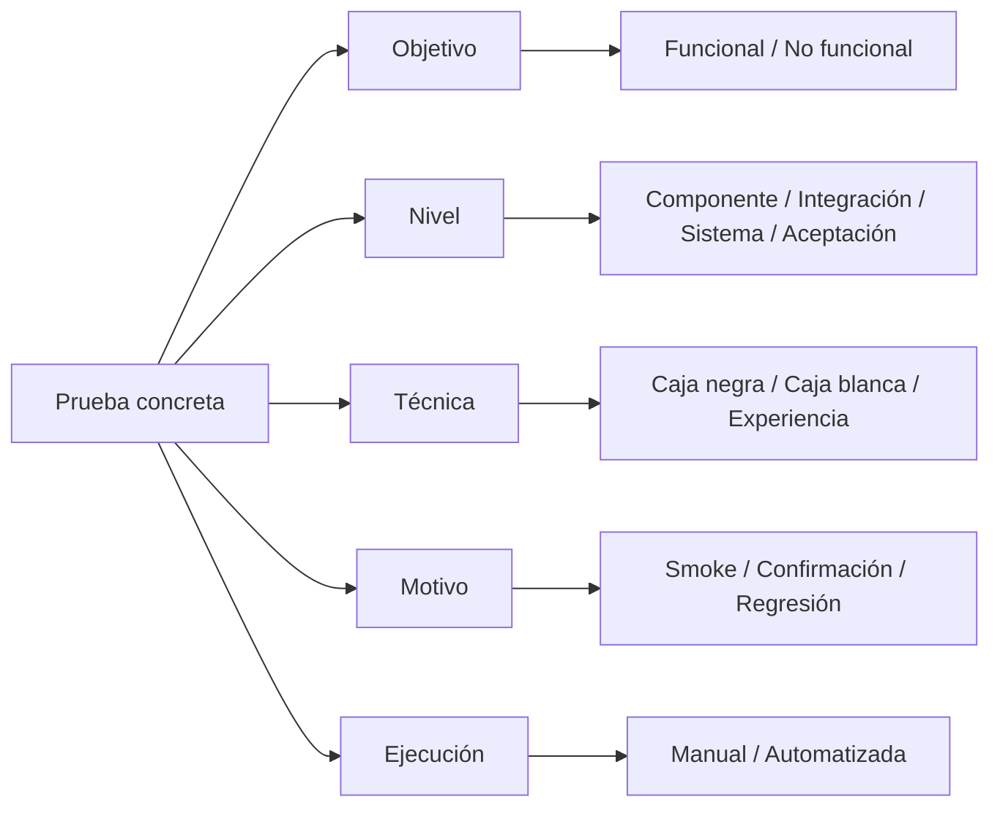

# SPEC-CONTENT-220 — Rediseño curricular del módulo «Fundamentos del Testing»

> **Proyecto:** QAPath Academy  
> **Clase de artefacto:** Especificación curricular, pedagógica y funcional TO-BE  
> **Versión del SPEC:** 1.0.0  
> **Fecha de elaboración:** 2026-10-28  
> **Estado:** **PROPUESTA PARA REVISIÓN — NO AUTORIZA IMPLEMENTAR**  
> **Módulo afectado:** `fundamentos` (semanas 1 y 2)  
> **Repositorio de referencia:** https://github.com/CristianHdez90/qapathAcademy  
> **Fuentes principales:** ISTQB CTFL v4.0.1, glosario ISTQB, Cucumber/BDD, ISO/IEC 25010:2023 y materiales editoriales suministrados por el responsable de QAPath Academy.  
> **Dependencia conceptual:** SPEC-CONTENT-210 (aprendizaje interactivo), SPEC-UX-120 (estudio enfocado), SPEC-UX-140 (globos contextuales), si están disponibles en el workspace. **Este archivo es autónomo** si no están presentes.

---

## 01. Intención

Rediseñar **exclusivamente los contenidos educativos** del módulo **Fundamentos del Testing** para que un estudiante sin experiencia pueda comprender, diferenciar y **aplicar en un equipo de desarrollo real** los tipos, niveles, enfoques, estrategias y principios de las pruebas de software.

El contenido debe ser riguroso con la terminología de **ISTQB CTFL v4.0.1**, estar actualizado mediante fuentes verificables y ofrecer una experiencia de aprendizaje **original**, progresiva, entretenida, interactiva y visual, comparable en claridad y dinamismo a plataformas de formación tecnológica conocidas, **sin copiar** sus lecciones, diseños, marcas ni recursos protegidos.

### 1.1 Problema a resolver

En el aprendizaje introductorio de QA suelen confundirse categorías distintas: pruebas **funcionales** frente a **no funcionales**, técnicas **caja negra** frente a **caja blanca**, niveles, pruebas **E2E**, **smoke**, **sanity**, **re-test**, **regresión**, exploración y ejecución manual o automatizada. Esa confusión impide elegir qué probar, cuándo hacerlo y quién debería colaborar.

También hay un problema pedagógico: bloques de texto extensos, ejemplos desconectados y varios conceptos visibles a la vez pueden dificultar la comprensión. Este SPEC propone **una idea principal por tarjeta**, práctica contextual, retroalimentación y grafos/diagramas que ayuden a relacionar los conceptos.

### 1.2 Resultado de aprendizaje global

Al terminar, el estudiante podrá:

1. Clasificar una prueba usando **dimensiones independientes** (objetivo, nivel, técnica, alcance, motivo, estilo y ejecución).
2. Distinguir las **cinco** categorías de niveles del CTFL v4.0.1 y reconocer nomenclaturas tradicionales que agrupan las integraciones.
3. Seleccionar comprobaciones unitarias, de integración, sistema, integración de sistemas y aceptación para un escenario realista.
4. Interpretar la pirámide de Cohn **como heurística para diseñar la cartera automatizada**, no como sinónimo de niveles ISTQB ni una imposición de responsabilidades exclusivas.
5. Explicar y aplicar los siete principios del testing, incluyendo la actualización de pruebas repetidas.
6. Redactar escenarios BDD de negocio con ejemplos y criterios comprobables.
7. Diferenciar **deployment** de **release**, seleccionar ambientes apropiados y proteger datos sensibles.
8. Fundamentar sus decisiones de QA con un **mapa de riesgos, casos, evidencias y una recomendación de entrega**.

### 1.3 Alcance y línea base

En la versión del repositorio inspeccionada, el catálogo asigna `fundamentos` a las semanas **1 y 2**; ambas guías están en `libs/content/src/data/study-guides.json`. Hay pruebas automáticas que esperan **24 guías globales**, **3 secciones por cada semana inicial** y un conjunto fijo de **48 tarjetas** en las dos semanas. Estos son **acoplamientos de implementación actuales**, no requisitos pedagógicos inmutables. Codex debe inventariarlos antes de proponer una migración; no romperlos silenciosamente ni cambiar la estructura global sin autorización.

**Decisión propuesta:** desarrollar ocho **capítulos curriculares**, cuatro por semana, manteniendo los identificadores de semana 1 y 2. Esta distribución requiere **aprobación explícita de la migración de estructura y de las pruebas afectadas**. Como alternativa temporal, los ocho capítulos pueden representarse como subcapítulos dentro de las seis secciones existentes. La elección debe documentarse antes de implementar.

---

## 02. Comportamiento

### 2.1 Arquitectura pedagógica y reglas generales

Cada capítulo se impartirá con una secuencia consistente:

| Orden | Elemento | Comportamiento requerido |
|---|---|---|
| 1 | **Situación inicial** | Un problema breve de un equipo de desarrollo que genere curiosidad y una decisión por tomar. |
| 2 | **Objetivos comprobables** | 2–4 objetivos expresados con verbos observables: distinguir, clasificar, diseñar, justificar, aplicar. |
| 3 | **Tarjetas de concepto** | Una idea principal por tarjeta, explicación breve y ejemplo progresivo. No mostrar todas las tarjetas simultáneamente. |
| 4 | **Caso de equipo real** | Producto ficticio coherente, historia de usuario, roles, cambio, criterio, prueba, defecto o riesgo y evidencia. |
| 5 | **Grafo de relaciones** | Diagrama Mermaid o representación estructurada, con título, nodos, enlaces, descripción textual y alternativa accesible. |
| 6 | **«Así se aplica»** | Flujo de 3–5 estados; cada estado dispone de acciones, responsable posible, evidencia y resultado. |
| 7 | **Interacción** | Clasificación, decisión de riesgo, secuenciación, tabla, exploración o simulación con feedback explicativo. |
| 8 | **Comprueba lo aprendido** | 2–4 preguntas breves por capítulo; explicar por qué una respuesta es correcta y las otras no. |
| 9 | **Transferencia** | Reto con entregable que pueda utilizarse en un sprint real (matriz, escenario, mapa o reporte). |
| 10 | **Continuidad** | Paginación, regreso, reanudación y persistencia sin otorgar puntos por clics o animaciones. |

**Patrón editorial común:** «Qué problema aparece → qué significa el concepto → cómo toma una decisión el equipo → qué hace QA → qué demuestra la evidencia → qué harías tú». Utilizar español claro, tecnicismos explicados al aparecer y cifras/datos ficticios coherentes. Se permite humor ligero y preguntas retadoras, sin sacrificar precisión.

**Estudio enfocado:** una tarjeta de conocimiento activa en pantalla; «Anterior / Siguiente» y un índice accesible; permitir volver al material ya recorrido. La lectura y el progreso obedecen a las reglas educativas existentes y no deben confundirse con meras visitas.

### 2.2 Caso transversal: «ReservaYa»

Para unir los capítulos se usará un **producto ficticio** de reservas de turnos de una clínica/centro de servicios, con un equipo Scrum formado por PO, QA, frontend, backend y DevOps. La clínica es solo una **simulación pedagógica**: ningún dato personal o médico real.

**HU-RES-01 — Crear reserva:** «Como usuario autenticado, quiero reservar un bloque disponible para obtener una cita sin que el mismo turno sea asignado a dos personas». Reglas iniciales: no reservar en el pasado, horarios en bloques de una hora, respuesta de conflicto si otro usuario reservó antes, confirmación en interfaz. Estas reglas son **datos de aprendizaje**, no nuevas funcionalidades solicitadas a QAPath Academy.

Durante las clases surgirán cambios: un defecto por doble reserva, demoras, dependencia de un servicio externo, ajuste de reglas y activación progresiva mediante feature flag. Cada capítulo mostrará la perspectiva relevante, sin repetir idéntico ejemplo mecánicamente.

### 2.3 Estructura definitiva del módulo: ocho capítulos

> **Normalización de numeración:** las propuestas recibidas contenían un «Capítulo 3» duplicado y un «Capítulo 7» repetido. Se organizan a continuación como capítulos **01–08**, sin eliminar ningún tema.

| Semana propuesta | Capítulo | Título | Resultado concreto |
|---|---|---|---|
| 01 | 01 | **Tipos de pruebas de software: qué evaluamos y cómo** | Clasifica funcional/no funcional y caja negra/blanca sin mezclarlos. |
| 01 | 02 | **Enfoques y estrategias de pruebas** | Distingue E2E, smoke, sanity, re-test, regresión, exploratorio, basado en casos, manual/automatizado. |
| 01 | 03 | **Cinco niveles de prueba según ISTQB** | Asigna pruebas a componente, integración de componentes, sistema, integración de sistemas y aceptación. |
| 01 | 04 | **Pirámide de Cohn y trabajo conjunto QA–DEV** | Diseña una cartera equilibrada y distribuye responsabilidades según contexto. |
| 02 | 05 | **Los siete principios del testing** | Justifica decisiones de prueba basadas en riesgo, oportunidad y utilidad. |
| 02 | 06 | **Resolviendo dudas: mapa definitivo de clasificaciones** | Resuelve confusiones con una matriz multidimensional y casos ambiguos. |
| 02 | 07 | **Behavior-Driven Development (BDD)** | Colabora con ejemplos y redacta escenarios Given/When/Then verificables. |
| 02 | 08 | **Deployment, release y ambientes de software** | Distingue despliegue/lanzamiento y elige ambientes/datos de manera segura. |

### 2.4 Especificación de los capítulos

#### CAPÍTULO 01 — Tipos de pruebas: ¿qué queremos evaluar?

**Intención didáctica:** que el estudiante aprenda a hacer preguntas distintas: «¿cumple la función?», «¿con qué calidad opera?» y «¿conozco la estructura interna?». No presentar **funcional = caja negra** como equivalencia universal ni **no funcional = caja blanca** como oposición.

**Contenidos mínimos:**
- Funcionales: verifican comportamiento y requisitos (p. ej., se impide la doble reserva).
- No funcionales: rendimiento, seguridad, usabilidad, compatibilidad, confiabilidad y otras características del modelo ISO/IEC 25010:2023, sin reproducir el estándar íntegro.
- Caja negra, caja blanca y técnicas basadas en experiencia como **dimensión del diseño de casos**; explicar que pueden aplicarse a objetivos funcionales o no funcionales.
- Pruebas **estáticas** (revisión del requisito de reservas sin ejecutar) frente a **dinámicas** (ejecutar código), como otra dimensión.

**Historia de equipo:** el PO solicita reservar un turno, QA plantea conflicto concurrente, DEV diseña una regla de atomicidad y el equipo pregunta cómo comprobar capacidad y accesibilidad.

**Grafo requerido:** `Objetivo (funcional/no funcional) × Técnica (negra/blanca/experiencia) × Ejecución (estática/dinámica)`. Diagrama con conexiones no jerárquicas que evidencie combinaciones posibles.

**Interacción:** clasificar seis tarjetas de ejemplo en dos o más dimensiones; feedback sobre por qué «prueba de carga del checkout mediante requests» es no funcional y puede ser caja negra.

**Entregable:** tabla de seis pruebas de ReservaYa, cada una con objetivo, técnica, evidencia y riesgo.

#### CAPÍTULO 02 — Enfoques y estrategias: cuándo, para qué y de qué modo

**Contenidos mínimos por eje:**
- **Alcance:** E2E de reserva desde UI hasta confirmación; no equiparar E2E con todas las pruebas de sistema.
- **Propósito de validación rápida:** smoke tras una nueva build; sanity como revisión focalizada (terminología de uso habitual, variable según equipos, no una categoría normativa rígida).
- **Relacionadas con cambios:** confirmation/re-test del defecto de doble reserva; regresión de reservas existentes, notificaciones y cancelación.
- **Enfoque de diseño/ejecución:** exploratorias con misión y anotaciones frente a pruebas basadas en casos previamente documentados; ambas pueden coexistir.
- **Forma de ejecución:** manual y automatizada; ambas pueden ser funcionales o no funcionales; selección basada en valor, costo y estabilidad.

**Grafo requerido:** mapa de ejes independientes más un **árbol de decisión** para elegir smoke/re-test/regresión tras un arreglo.

**Interacción:** simulador de cambio: «DEV corrigió concurrencia; tienes 30 minutos; selecciona comprobaciones y explica el riesgo residual». Mostrar feedback, no penalizar alternativas razonables si están justificadas.

**Entregable:** mini plan de pruebas con smoke, re-test, regresión, una misión exploratoria y candidato a automatización.

#### CAPÍTULO 03 — Niveles ISTQB: qué pieza o integración observamos

**Precisión normativa obligatoria:** CTFL v4.0.1 describe **cinco niveles**: **componente**, **integración de componentes**, **sistema**, **integración de sistemas** y **aceptación**. Explicar que muchas introducciones agrupan las integraciones en un solo «nivel de integración» y por eso enseñan cuatro niveles simplificados; esa versión tradicional **no reemplaza** la enumeración del CTFL consultado.

| Nivel | Objeto de prueba en ReservaYa | Participación habitual, no exclusiva |
|---|---|---|
| Componente | Validador de fecha anterior a hoy | DEV, con posible colaboración de QA |
| Integración de componentes | Servicio de reservas + repositorio de datos | DEV y QA |
| Sistema | Plataforma completa para reservar turno | QA y DEV |
| Integración de sistemas | ReservaYa + proveedor externo de notificaciones | QA, DEV y especialistas de integración |
| Aceptación | PO/usuario valida que se cumple la necesidad del negocio | Negocio/usuarios con soporte del equipo |

**Contenido de rol:** la responsabilidad es del **equipo completo**; evitar mensajes de «unitarias son exclusivamente DEV» o «aceptación es exclusivamente QA».

**Grafo requerido:** sistema con componentes, bases y proveedores, más enlaces de nivel que permitan observar el alcance. Distinguir «integración de componentes» de «integración de sistemas» mediante colores y leyendas descriptivas.

**Interacción:** estudiante arrastra o selecciona siete ejemplos hacia el nivel más representativo, con explicación de combinaciones y contextos.

**Entregable:** matriz de niveles / objetivo / responsabilidad / evidencia para la HU-RES-01.

#### CAPÍTULO 04 — Pirámide de Cohn: cartera, costo y responsabilidades

**Contenidos mínimos:** capas típicas «unitarias → servicios/integración → interfaz/E2E», principio de más pruebas rápidas y aisladas y menos recorridos amplios, **sin inventar porcentajes obligatorios ni afirmar que todas las aplicaciones necesitan idéntica forma**. Distinguir que la pirámide de Cohn es un modelo de estrategia de automatización y que **no coincide 1:1 con los cinco niveles ISTQB**. Introducir brevemente cuadrantes de prueba como mapa complementario, no reemplazo.

**Contexto real:** un equipo creó 70 escenarios E2E lentos y frágiles; debe reducir el tiempo de feedback moviendo reglas puras a componente e interacciones a contratos/integración, manteniendo unos pocos E2E de alto valor.

**Grafo requerido:** pirámide explicada + flujo PR → pruebas rápidas → integración → flujos críticos → decisión. Para accesibilidad ofrecer lista ordenada y alternativa textual.

**Interacción:** distribuir 12 escenarios por capa y equipo responsable (QA, DEV, negocio, colaborativo); explicar ventajas y límites; demostrar que una etiqueta de rol no sustituye la responsabilidad compartida.

**Entregable:** propuesta de suite por riesgo y tiempo, con al menos una prueba por categoría y justificación.

#### CAPÍTULO 05 — Los siete principios del testing

Presentar el lenguaje del CTFL y variantes didácticas conocidas, sin cambiar el sentido:

1. Las pruebas muestran la **presencia**, no la ausencia, de defectos.
2. Las pruebas **exhaustivas son imposibles** (salvo casos triviales).
3. Las pruebas **tempranas** ahorran tiempo y dinero.
4. Los **defectos se agrupan** en determinadas zonas.
5. Las **pruebas pierden eficacia** si se repiten sin evolucionar (tradicionalmente: «paradoja del pesticida»); aclarar que la regresión repetida sigue siendo valiosa.
6. Las pruebas **dependen del contexto**.
7. **Falacia de ausencia de defectos:** un producto sin fallos detectados puede no aportar valor ni satisfacer a sus usuarios.

**Historia:** el equipo prueba exhaustivamente botones poco críticos, pero no revisa la concurrencia de reservas; posteriormente corrige el módulo más problemático sin actualizar sus datos ni escenarios.

**Grafo requerido:** siete nodos conectados a decisiones del sprint y evidencia correspondiente; evitar convertir la lista en una secuencia falsa.

**Interacción:** «Decide con criterio»: siete microescenarios, uno por principio, con explicaciones de por qué otras respuestas son menos convenientes.

**Entregable:** priorización de 5 riesgos y una propuesta de mejora temprana de requisitos.

#### CAPÍTULO 06 — Preguntas frecuentes y mapa para deshacer confusiones

Convertir las dudas de la guía proporcionada por el responsable del proyecto (Cooltesters) en **contenido original**, sin transcribir ni copiar fragmentos extensos, tablas o gráficos protegidos.

**Preguntas obligatorias:**
1. ¿Qué son las pruebas de software y por qué no equivalen solamente a ejecutar casos?
2. ¿Qué diferencia un nivel de prueba de un tipo, una técnica o una estrategia?
3. ¿Por qué aparecen 4 niveles en algunos cursos y 5 en CTFL v4.0.1?
4. ¿Por qué funcional/no funcional y caja negra/caja blanca se pueden combinar?
5. ¿Qué cambia entre re-test y regresión?
6. ¿Cuándo conviene prueba estática frente a dinámica?
7. ¿En qué categoría están E2E, smoke, sanity y exploratoria?
8. ¿En qué se diferencia la pirámide de los cuadrantes?
9. ¿Cómo selecciono pruebas de acuerdo al riesgo y las capacidades del equipo?
10. ¿Qué debería automatizar y qué conviene mantener manual o exploratorio?

**Grafo requerido:** mapa conceptual central «una misma prueba se describe desde varios ejes», con enlaces a los capítulos anteriores.

**Interacción principal:** **clasificador multidimensional** de escenarios: ejemplo «Playwright comprueba la reserva de punta a punta tras un despliegue» → sistema / funcional / negra / E2E / smoke si pertenece al subconjunto crítico / automatizada. Permitir **varias etiquetas simultáneas** y explicar condiciones, en vez de exigir una sola clasificación.

**Entregable:** chuleta didáctica propia con glosario, tabla comparativa y ejemplos contextualizados.

#### CAPÍTULO 07 — Behavior-Driven Development (BDD)

**Contenidos mínimos:** BDD como proceso de **conversación, descubrimiento de ejemplos, formulación y automatización**, con participación de negocio, QA y desarrollo; no reducirlo a «escribir escenarios en Gherkin», ni presentar a Cucumber como requisito para aplicar BDD. Diferenciar escenarios de negocio (Given/When/Then), casos manuales con pasos y aserciones técnicas de bajo nivel.

**Historia del equipo:** en refinamiento, el PO dice «dos usuarios no pueden tomar el mismo turno», QA propone contraejemplo simultáneo y DEV identifica condición de carrera.

**Ejemplo original de escenario:**

```gherkin
Característica: Reserva exclusiva de turnos

  Escenario: Evitar doble reserva del mismo turno
    Dado que el turno de las 10:00 está disponible
    Y que dos usuarios autenticados intentan reservarlo
    Cuando ambos confirman la reserva casi al mismo tiempo
    Entonces solo una reserva queda confirmada
    Y el otro usuario recibe un mensaje de conflicto
```

Aclarar que «casi al mismo tiempo» exige control preciso de concurrencia y datos para automatizarse; el ejemplo sirve primero para descubrir la regla.

**Grafo requerido:** descubrimiento (ejemplos) → formulación (escenarios) → automatización opcional → feedback → refinamiento; roles en cada etapa.

**Interacción:** constructor de Gherkin: ordenar precondiciones, evento y resultados; detectar escenarios ambiguos y transformarlos con ejemplos observables.

**Entregable:** tres escenarios de negocio (positivo, conflicto y fecha pasada), más preguntas pendientes al PO.

#### CAPÍTULO 08 — Deployment, release, feature flags y ambientes

**Contenidos mínimos:**
- **Deployment** = llevar una versión a un entorno; **release** = habilitar o poner valor a disposición del usuario. No siempre ocurren al mismo tiempo.
- **Feature flags** y lanzamientos progresivos: capacidad de habilitar, deshabilitar, medir y revertir funciones (sin prometer que todos los flags sean mecanismos de seguridad).
- Ambientes posibles y su **variación organizacional**, no un pipeline universal rígido:

| Ambiente | Propósito frecuente | Responsables habituales | Política de datos de ejemplo |
|---|---|---|---|
| Local / desarrollo | Construir, depurar y probar componentes | DEV, QA Automation | Datos sintéticos; credenciales de prueba |
| QA / Testing | Validar requisitos, flujos y defectos | QA y equipo | Datos sintéticos, anonimizados o simulados según necesidad |
| Staging / Preproducción | Ensayar integraciones, configuración y flujos próximos a producción | QA, DEV, DevOps, negocio | **Preferir sintéticos**; si se copian, enmascarar y autorizar, sin exponer secretos |
| Producción | Prestar el servicio real; observabilidad y validación limitada y controlada | Usuarios, operaciones, soporte | Datos reales protegidos por controles de acceso y privacidad |

- Puede haber sandbox, integración, UAT y entornos efímeros por PR. No afirmar que todas las organizaciones tienen cada entorno o que en QA solo se usan mocks.

**Historia:** ReservaYa se despliega el jueves con la nueva reserva protegida por flag; el PO decide lanzarla el lunes al 10 % de usuarios tras evidencia y métricas.

**Grafo requerido:** commit → CI → ambiente QA → staging → deployment producción → flag OFF/ON → release → monitoreo/reversión; especificar que la ruta depende de la organización.

**Interacción:** simulador «release o rollback»: el estudiante analiza evidencia, fallos de API y métricas ficticias; decide si activar la función, mantenerla desactivada o revertir.

**Entregable:** checklist de calidad previo a lanzamiento, ambiente, datos, smoke post-deployment y decisión razonada de release.

### 2.5 Formato obligatorio de cada tarjeta/concepto

Cada tarjeta deberá proveer estos campos **editoriales**, independientemente de su implementación técnica:

```yaml
id: "FND-W01-C03-T02"             # ID estable, único
capitulo: "FND-C03"
titulo: "Integración de sistemas"
objetivo: "Distinguirla de la integración entre componentes"
contexto: "ReservaYa envía notificaciones a un servicio externo"
explicacion: "Texto breve, preciso y original"
ejemplo:
  situacion: "El proveedor responde 503"
  decision_qa: "Validar reintento controlado y estado de la reserva"
  evidencia: "Contrato API y traza sin información personal"
grafo:
  tipo: "flowchart"
  fuente_mermaid: "..."         # Solo si realmente aporta comprensión
  descripcion_textual: "Representación equivalente para lectores de pantalla"
demostracion:
  pasos:
    - titulo: "Preparar entorno"
      acciones:
        - "Configurar un proveedor simulado"
        - "Definir una respuesta de error 503"
      responsable: "DEV y QA, en colaboración"
      evidencia: "Prueba reproducible"
    - titulo: "Ejecutar integración"
      acciones: ["Invocar API", "Observar respuesta y reintentos"]
      responsable: "QA"
      evidencia: "Log de prueba anonimizado"
    - titulo: "Evaluar resultado"
      acciones: ["Contrastar criterios", "Registrar decisión"]
      responsable: "Equipo"
      evidencia: "Reporte y riesgo residual"
actividad:
  tipo: "decision"
  pregunta: "¿Qué comprobarías tras un 503?"
  opciones: ["...", "..."]
  respuesta_razonada: "..."
fuentes:
  - titulo: "ISTQB CTFL v4.0.1"
    url: "https://www.istqb.org/certifications/certified-tester-foundation-level-ctfl-v4-0/"
    consultado: "2026-10-28"
```

**Este YAML es un esquema de autoría conceptual, NO un contrato que deba adoptarse directamente.** Codex debe proponer cómo mapearlo a los JSON, DTO de `ReadingConcept` y componentes actuales sin introducir campos incompatibles sin pruebas.

### 2.6 «Así se aplica»: globos interactivos por estado

La demostración visual vigente de QAPath Academy muestra pasos y una línea animada. Se requiere un **globo contextual con lista de acciones por estado**, preservando la secuencia general.

**Reglas de interacción:**

- **Mouse / hover:** abrir el globo del nodo apuntado; mantenerlo abierto mientras el puntero entra al globo, evitando que desaparezca al leer.
- **Teclado:** el nodo es alcanzable con `Tab`; `Enter`/`Espacio` abren o fijan el globo, `Escape` lo cierra y devuelve el foco al nodo.
- **Touch / tap:** un toque muestra el globo; segundo toque, cierre explícito o selección de otro nodo cambia el estado sin depender de hover.
- **Scroll:** al alcanzar el componente visible (usar `IntersectionObserver` o equivalente) y **estabilizarse** el desplazamiento, puede mostrarse el globo del **estado activo**; no disparar decenas de aperturas por movimiento ni robar foco automáticamente. El scroll no debe marcar aprendizaje completado.
- **Animación:** puede pausarse temporalmente mientras se estudia un globo; respetar pausa manual, reanudación explícita y `prefers-reduced-motion`.
- **Un solo globo a la vez** por demostración; permitir cambiar de nodo sin perder lo leído ni la secuencia.
- **Posicionamiento:** el globo no debe cubrir el texto de lectura ni exceder el viewport. En móviles presentar la explicación como panel asociado debajo del flujo si un popover flotante no cabe.
- **Accesibilidad:** nombre accesible del nodo, `aria-expanded`/`aria-controls` cuando proceda, foco visible, escape, lectura compatible con lectores de pantalla, tiempo suficiente y cierre no obligatorio por temporizador; cumplir principios pertinentes de **WCAG 2.2 AA**.
- **Datos:** cada globo proviene de las **acciones editoriales aprobadas**, nunca de texto generado en tiempo real ni de afirmaciones inventadas por el frontend.

**Ejemplo obligatorio para CAP-03 (integración de sistemas):**

| Estado | Acciones del globo | Evidencia |
|---|---|---|
| Preparar integración | Revisar contrato externo; simular 503; definir resultado esperado | Contrato y datos ficticios |
| Ejecutar intercambio | Enviar solicitud; comprobar reintento; inspeccionar respuesta | Traza anonimizada |
| Evaluar recuperación | Confirmar estado consistente; registrar incidencia o conformidad | Resultado y riesgo residual |

**Distinguir evento de atención y resultado pedagógico:** un estudiante puede abrir todos los globos por curiosidad; esto **no equivale** a completar lectura, actividad, quiz o semana.

### 2.7 Diagramas, grafos y mapas tipo Obsidian

Los diagramas deben existir como **fuente de texto versionable** (preferir Mermaid compatible con Markdown/Obsidian), con representación accesible. Seleccionar el diagrama según el objetivo:

- **Mapa conceptual/grafo** para relaciones no jerárquicas (tipos ↔ niveles ↔ enfoques).
- **Flowchart** para un proceso o decisión (re-test vs regresión, BDD, release).
- **Sequence diagram** para comunicación entre UI, API, base y proveedor externo.
- **State diagram** para el estado de reserva o de defecto.
- **Pirámide ilustrada** para heurísticas de automatización, con alternativa textual.

**Grafo de ejemplo (capítulos 01–03):**



El grafo **simplifica nodos para lectura**, pero el capítulo de niveles debe enseñar por separado las **dos formas de integración**. No usar un grafo que confunda una dimensión con otra. Mermaid es un formato técnico de diagramas, **no** un sustituto de actividades evaluables.

### 2.8 Evaluación, gamificación ligera y retroalimentación

- Microactividades auténticas: arrastrar/clasificar, tablas de decisión, ordenar pasos, elegir estrategia, descubrir errores en una HU, completar Gherkin y decidir lanzamiento.
- Retroalimentación **inmediata y explicativa**; evitar «Incorrecto, intenta de nuevo» sin razonamiento. Permitir reintentar y revisar la respuesta.
- Evaluar capacidad de transferencia, no solo memorización. Usar distractores plausibles basados en confusiones habituales.
- Mantener navegación por teclado y alternativa a arrastrar; no depender de cronómetros, movimiento o color como única señal.
- No modificar el criterio de completitud académico vigente ni sumar puntos, insignias o porcentajes sin una SPEC adicional.
- Quiz del módulo: incluir preguntas de clasificación combinada, niveles (5), BDD, principios y despliegue. Guardar evidencias sin exponer respuestas antes de evaluar cuando el flujo actual las protege.
- Entrega final: **Plan QA de ReservaYa**, con matriz de 10 escenarios, tres escenarios BDD, propuesta de pirámide, mapa de ambiente/release y decisión de salida basada en riesgo.

### 2.9 Plan de migración curricular compatible con el proyecto existente

**G0 — Inventario:** registrar SHA, datos JSON, relaciones con progreso y tests. Enumerar todos los `id` de semana, sección, concepto, quiz y enlaces usados por el frontend. Revisar qué archivos dependen de `sections.length === 3`, conteo de 48 tarjetas y hashes `chapter-0`, etc.

**G1 — Contenido, sin código:** producir ocho documentos editoriales de capítulo y un mapa de correspondencias AS-IS → TO-BE (qué se conserva, mueve, amplía o queda pendiente). Verificar fuentes oficiales y precisión.

**G2 — Piloto:** diseñar **CAP-01** completo y su actividad; revisar el contenido, los diagramas y criterios de accesibilidad con el responsable del proyecto.

**G3 — Aprobación de contrato técnico:** decidir entre subcapítulos compatibles o nuevo conteo de secciones. Mantener `week.id` 1 y 2. Proponer ajuste explícito de datos, DTO, pruebas de contenido, indexación, historial, seguimiento de lectura y comportamiento de enlaces; plan de migración para alumnos con progreso previo.

**G4 — Implementación incremental:** tras autorización expresa, un capítulo o lote pequeño por PR; cambios acotados y reversibles; sin ajustes ajenos al módulo `fundamentos`.

**G5 — Evidencia y liberación:** ejecutar `pnpm check`, tests de contenido, Playwright de estudio y accesibilidad, pruebas manuales de lectura real y validación en preview de Vercel antes de promover producción.

### 2.10 Contratos técnicos a inspeccionar antes de editar

| Área | Archivo actual / comportamiento | Protección exigida |
|---|---|---|
| Catálogo | `libs/content/src/data/catalog.json` | No reenumerar otras semanas ni cambiar identidad de módulos. |
| Fuente de guías | `libs/content/src/data/study-guides.json` | No perder textos, links, claves ni evaluaciones sin plan de correspondencias. |
| Contratos | `packages/contracts/src/index.ts` (`ReadingConcept`, `StudyGuide`) | Cambios de DTO/versionado explícitos; opcionalidad de nuevos campos. |
| Pantalla | `apps/web/src/components/academy/lesson-study.tsx` | Conservar navegación por apartados, notas, descarga y evaluaciones. |
| Tarjetas | `apps/web/src/components/academy/reading-concepts.tsx` | Mantener semántica, rol y ejemplos laborales. |
| Animaciones | `apps/web/src/components/academy/concept-demonstration.tsx` | Conservar pause/play/reduced-motion; añadir globos sin eventos espurios. |
| Cobertura de lectura | `apps/web/src/features/progress/use-reading-tracker.ts` | No contar scroll, popovers o clicks como lectura válida por sí solos. |
| Paginación | `apps/web/src/features/progress/use-lesson-pagination.ts` | Preservar deep links, historial y navegación accesible. |
| Tests | `tests/content.test.mjs`, `tests/reading-concepts.test.mjs`, E2E relacionados | Actualizar expectativas solo con diseño aprobado, no borrar pruebas para «poner verde» CI. |
| Progreso | `libs/progress/`, API y persistencia PostgreSQL | Preservar progreso histórico, intentos de quiz y notas. |

---

## 03. Restricciones

### 3.1 Restricciones críticas

1. **Modo inicial: SOLO DOCUMENTACIÓN.** Codex puede leer código y crear propuestas Markdown bajo `docs/specs/content/`. No podrá editar JSON, TSX, CSS, pruebas, dependencias, migraciones ni configuración hasta que el responsable apruebe un plan técnico de implementación.
2. **Conservar funcionalidades existentes:** login/MFA, guardado de notas, progreso, quizzes, laboratorios, navegación y compatibilidad con la versión publicada de QAPath Academy.
3. **Respetar alcance:** únicamente el módulo `fundamentos` (semanas 1–2). Ninguna modificación a los otros siete módulos sin SPEC posterior.
4. **No cambiar IDs de progreso sin migración y compatibilidad.** Los estudiantes que ya completaron actividades deben conservar evidencia y trazabilidad.
5. **No asumir responsabilidades exclusivas por cargo.** DEV, QA, PO, usuarios y DevOps colaboran; explicar participaciones habituales y límites según el proyecto.
6. **Precisión de taxonomía:** no igualar tipo, nivel, técnica, alcance, propósito, estilo de exploración y automatización. ISTQB CTFL 4.0.1 nombra cinco niveles; si se menciona la simplificación de cuatro, etiquetarla como tal.
7. **Fuentes verificables:** utilizar fuentes oficiales primero, registrar URL, versión y fecha de consulta; distinguir una recomendación editorial de una afirmación normativa. Revisar enlaces en la fecha efectiva de la edición.
8. **Originalidad:** no reproducir los cursos, tablas, recursos visuales ni expresiones extensas de Atlassian, IBM, Cooltesters, Platzi, EDteam, ISTQB u otros propietarios.
9. **Historias ficticias:** usar datos sintéticos y ninguna credencial, contacto real o información sensible. No solicitar pruebas destructivas en producción.
10. **WCAG 2.2 AA como objetivo verificable:** el sistema puede tener brechas actuales. No afirmar conformidad sin auditoría. Interacciones equivalentes para teclado, mouse y touch; manejo de foco, lectores de pantalla, contraste y movimiento reducido.
11. **Grafo accesible:** cada diagrama debe contar con versión textual y no introducir scripts o contenido HTML inseguro. Nunca generar nodos no verificables desde IA en producción.
12. **No inventar cifras oficiales:** no prescribir tamaños de pirámide, tiempos universales o porcentajes de defectos sin fuente clara y contexto.
13. **No simplificar por exceso:** smoke/sanity son términos prácticos de uso variable; E2E no es un nivel ISTQB independiente; BDD no es sinónimo de Cucumber; deploy no equivale a release.
14. **Evidencia obligatoria:** cada criterio de aceptación debe tener prueba prevista y ruta de evidencia. La revisión pedagógica humana complementa, no sustituye, la automatización.
15. **Vercel/CI:** no ejecutar despliegues, actualizar producción ni migrar PostgreSQL como efecto de redactar el SPEC.

### 3.2 Definition of Ready (DoR) de cada capítulo

- Objetivos y resultados observables definidos.
- Reglas alineadas con fuente oficial y terminología verificada.
- Caso realista y datos sintéticos seleccionados.
- Tarjetas, grafos y demostraciones desglosados.
- Interacción, solución, distractores y feedback documentados.
- Alcance, dependencias y trazabilidad de progreso claros.
- Riesgos técnicos y de accesibilidad identificados.

### 3.3 Definition of Done (DoD) de cada capítulo, tras aprobación de implementación

- Capítulo revisado por experto QA y revisor pedagógico.
- Todos los objetivos aparecen en la lectura y se evalúan con al menos una actividad.
- Ejemplos coherentes en contexto, decisión y evidencia.
- Diagramas legibles, con alternativa textual, y sin exceder ancho móvil.
- Globos accesibles por hover/foco/tap/scroll estable y sin capturar foco indebidamente.
- Pruebas automáticas y exploratorias relevantes aprobadas.
- Sin pérdida de notas, progreso, evaluaciones o enlaces previos.
- Registro de versión y bibliografía trazable.

---

## 04. No-Objetivos

- No construir una academia nueva ni rediseñar todos los módulos a la vez.
- No reescribir la arquitectura Clean/Hexagonal/DDD ni cambiar Next.js/NestJS/Drizzle/PostgreSQL/Firebase.
- No sustituir QAPath Academy por contenido copiado de plataformas comerciales.
- No convertir el material en una transcripción del temario ISTQB ni prometer acreditación o certificación oficial.
- No asignar «exclusividad» de tipos de prueba a QA o DEV.
- No añadir obligatoriedad de herramientas comerciales, cuentas externas o servicios de IA para completar las lecciones.
- No generar imágenes, videos o animaciones como requisito universal cuando un diagrama ligero sea suficiente.
- No automatizar en producción una prueba de concurrencia con impacto real en reservas o usuarios.
- No incrementar porcentajes de progreso por hacer hover, tap, scroll o visualizar globos.
- No modificar cuestionarios, bancos de preguntas o condiciones de aprobación sin revisión y pruebas.
- No cambiar otros módulos, infraestructura, permisos, seguridad ni pipeline CI/CD por conveniencia del rediseño.

---

## 05. Criterios de aceptación (criterios verificables)

| ID | Dado / Cuando / Entonces (resumen) | Evidencia solicitada |
|---|---|---|
| AC-01 | Dado el plan de Fundamentos, cuando se audita, entonces existen ocho capítulos 01–08 con objetivos y temario aprobados. | Matriz curricular. |
| AC-02 | Cuando se estudia tipos de prueba, entonces el alumno distingue funcional/no funcional de caja negra/blanca y puede combinarlos. | Quiz de doble clasificación. |
| AC-03 | Cuando se pregunta por niveles CTFL, entonces aparecen los cinco niveles, incluidas ambas integraciones. | Tarjeta y quiz. |
| AC-04 | Dado material de cuatro niveles, entonces se presenta como simplificación tradicional y no como enumeración completa v4.0.1. | Revisión editorial. |
| AC-05 | Cuando se usa la pirámide, entonces se diferencia de niveles ISTQB y se explican roles colaborativos. | Simulador de cartera. |
| AC-06 | Cuando se revisan los principios, entonces se enseñan los siete y se contextualiza la «paradoja del pesticida». | Microactividad de siete casos. |
| AC-07 | Cuando se clasifica un caso E2E smoke automatizado, entonces se aceptan varias categorías simultáneamente y se justifican. | Clasificador multidimensional. |
| AC-08 | Dado un cambio corregido, entonces el alumno selecciona re-test y regresión con objetivos diferentes. | Árbol de decisión. |
| AC-09 | Cuando se trabaja BDD, entonces se demuestra descubrimiento colaborativo antes del Gherkin y se verifica la comprensibilidad del escenario. | Rúbrica de tres escenarios. |
| AC-10 | Cuando se explica deployment/release, entonces existe un ejemplo con flag que muestre despliegue sin exposición a usuarios. | Simulación de release. |
| AC-11 | Cuando se estudian ambientes, entonces se explican protección de datos y excepciones de organización. | Checklist de ambientes. |
| AC-12 | Cuando se abre una lección, entonces se presenta una tarjeta principal a la vez, conservando navegación anterior/siguiente. | Playwright desktop/móvil. |
| AC-13 | Cuando el estudiante enfoca un nodo con mouse, teclado o touch, entonces puede leer sus acciones y evidencias sin pérdida accidental del globo. | Matriz de interacción E2E. |
| AC-14 | Cuando el flujo entra en viewport y el scroll se estabiliza, entonces puede aparecer el globo del nodo activo sin robar foco ni generar aperturas repetidas. | E2E con IntersectionObserver. |
| AC-15 | Cuando se activa `prefers-reduced-motion`, entonces la información permanece disponible sin animación obligatoria. | E2E accesibilidad. |
| AC-16 | Cuando un estudiante abre globos, entonces no se marca automáticamente una semana como completada. | Test de progreso negativo. |
| AC-17 | Cuando se actualizan capítulos, entonces las notas y avances previos siguen accesibles o existe migración aprobada que los conserva. | E2E regresión con fixture histórica. |
| AC-18 | Cuando se consulta un capítulo, entonces los enlaces bibliográficos, versión y fecha de verificación son rastreables. | Revisión editorial. |
| AC-19 | Cuando se usa una actividad de arrastrar, entonces existe una alternativa equivalente por teclado/toque y feedback comprensible. | Prueba accesibilidad. |
| AC-20 | Cuando se completa el módulo, entonces el estudiante entrega un Plan QA ficticio de ReservaYa justificando niveles, técnicas, enfoque y release. | Rúbrica aplicada. |
| AC-21 | Cuando se compila la aplicación tras migración aprobada, entonces pasan tests de dominio/contenido, typecheck, lint y build. | `pnpm check`. |
| AC-22 | Cuando se aprueba un capítulo piloto en preview, entonces no hay regresiones en MFA, rutas de estudio, notas, evaluación ni asistente. | Playwright + revisión manual. |

## 06. Entregables solicitados a Codex

**Fase documental (autorizada por este SPEC):**

```text
docs/specs/content/fundamentos/
├── 00-inventario-as-is.md
├── 01-matriz-curricular-y-fuentes.md
├── 02-mapa-as-is-to-be-y-riesgos.md
├── 03-piloto-capitulo-01.md
├── 04-contenido-de-los-8-capitulos-propuesto.md
├── 05-grafos-y-demostraciones.md
├── 06-interacciones-y-accesibilidad.md
├── 07-plan-de-migracion-y-regresion.md
└── 08-matriz-criterios-de-aceptacion.md
```

- **00** incluye SHA/branch y dependencias reales de código.
- **01** inventaría enlaces y versiones normativas, distinguiendo fuente primaria/secundaria.
- **02** declara incompatibilidades, especialmente seis secciones actuales vs ocho capítulos y 48 tarjetas fijas de tests.
- **03** constituye un **piloto editorial completo**, no un cambio a producción.
- **04** describe los ocho capítulos con objetivos, tarjetas y casos.
- **05** contiene fuentes Mermaid, alternativas textuales y acciones detalladas por globo.
- **06** contiene matriz desktop/teclado/touch/movimiento reducido y puntos de foco.
- **07** explica impacto en contenido JSON, DTO, progreso, enlaces, tests y plan reversible.
- **08** vincula AC-01–AC-22 con archivos, actividades y pruebas.

**Fase técnica posterior (NO autorizada):** implementación en React/Next, modificación de datos, migraciones y despliegues. Requiere aprobación explícita del piloto y de G3.

## 07. Instrucción lista para Codex, Claude Code o Cursor

> Lee `docs/specs/SPEC-CONTENT-220-Fundamentos-del-Testing-TO-BE.md` y actúa como Lead QA Engineer, diseñador instruccional y arquitecto frontend. Analiza la implementación real del módulo `fundamentos` en QAPath Academy. Ejecuta **únicamente G0, G1 y G2 en modo documentación**, creando archivos `.md` dentro de `docs/specs/content/fundamentos/`. Reconstruye la estructura actual, contrástala con ISTQB CTFL v4.0.1 y las fuentes oficiales, y prepara el piloto editorial del Capítulo 01, la matriz completa de ocho capítulos, los grafos Mermaid y los globos con acciones/evidencias por estado. Señala explícitamente el impacto de pasar de 3 secciones por semana a 4 capítulos por semana. **No modifiques código, JSON, tests, progreso, dependencias, base de datos ni producción sin mi aprobación explícita.** Devuelve rutas de archivos creados, decisiones pendientes y criterios de aceptación trazados.

## 08. Fuentes y verificaciones (referencias, no material para copiar)

**Fuentes oficiales prioritarias:**

1. **ISTQB — Certified Tester Foundation Level (CTFL v4.0, syllabus v4.0.1):** https://www.istqb.org/certifications/certified-tester-foundation-level-ctfl-v4-0/  
   **PDF primario:** https://istqb.org/wp-content/uploads/2024/11/ISTQB_CTFL_Syllabus_v4.0.1.pdf  
   Especialmente 1.3 (principios), 2.2 (niveles, tipos, confirmación/regresión), 4.1–4.5 (técnicas y colaboración) y 5.1.6–5.1.7 (pirámide y cuadrantes).
2. **Glosario ISTQB — Confirmation testing:** https://glossary.istqb.org/en_US/term/confirmation-testing
3. **Cucumber — BDD, descubrimiento, formulación y automatización:** https://cucumber.io/docs/bdd/
4. **Cucumber — Gherkin:** https://cucumber.io/docs/gherkin/reference/
5. **ISO/IEC 25010:2023 — Modelo de calidad del producto:** https://www.iso.org/standard/78176.html
6. **W3C — WCAG 2.2:** https://www.w3.org/TR/WCAG22/
7. **Martin Fowler — Practical Test Pyramid (referencia explicativa):** https://martinfowler.com/articles/practical-test-pyramid.html

**Fuentes secundarias facilitadas para inspirar preguntas y estructura — contrastar con primarias:**

- Atlassian (tipos de pruebas): https://www.atlassian.com/es/continuous-delivery/software-testing/types-of-software-testing
- IBM (testing): https://www.ibm.com/es-es/think/topics/software-testing
- Cooltesters (preguntas y taxonomías, no transcribir): https://cooltesters.com/blogs/guias/tipos-de-pruebas-de-software
- TestingIT: https://www.testingit.com.mx/blog/niveles-de-pruebas-de-software
- Hiberus (principios): https://www.hiberus.com/crecemos-contigo/siete-principios-que-deben-guiar-el-testing-de-software-segun-istqb/

**Verificación editorial inicial (2026-10-28):** la página oficial de ISTQB enlaza el syllabus CTFL v4.0.1 (15-09-2024); el documento diferencia cinco niveles y cuatro tipos, con distinciones importantes entre **objetivo** y **enfoque estructural**. ISO/IEC 25010:2023 describe nueve características de calidad del producto. BDD se trata como colaboración sobre ejemplos, no simplemente como un framework. Todos los enlaces y versiones deberán revisarse nuevamente antes de publicar el contenido final.

---

**Regla de cierre:** este archivo es una **especificación de diseño y contenido, no una orden de despliegue**. Solo después de aprobar el piloto, la correspondencia AS-IS → TO-BE y el plan de migración se podrán producir cambios implementables, medidos por sus criterios de aceptación y por la conservación del progreso de los estudiantes.
