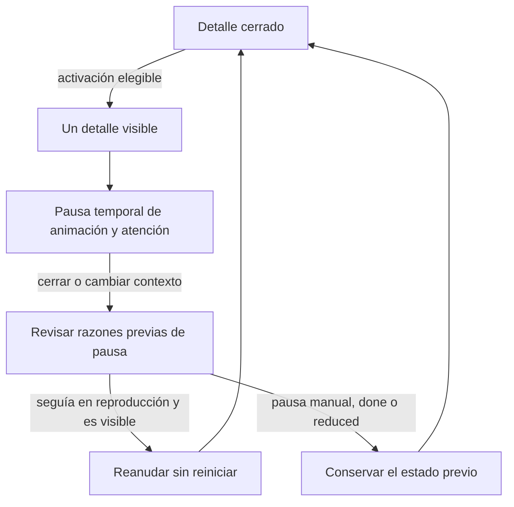

# G2 · Contrato propuesto de grafos y globos

**Seguimiento:** este contrato fue la propuesta G2. El alcance completo W01-C01 fue aprobado después y aplicado en local según el [acta individual](W01-C01-acta-implementacion-local.md); sus comportamientos siguen pendientes de validación final. El resto del currículo no está autorizado por este lote.

2026-10-28 · DOCUMENTATION_ONLY · No aplicado a tipos, JSON, CSS o componentes. Fuentes S08–S10/S22/S23 en [registro](00-baseline-y-fuentes.md). Requiere G3 y SPEC individual de implementación.

## 1. Decisión de representación

**Propuesta G2:** usar HTML semántico y CSS para la secuencia de tres estados ya existente; una lista ordenada comunica toda la relación sin animación. Los Mermaid del capítulo son fuente de diseño editable y alternativa para documentación/exportación; **no añadir un motor Mermaid ni ejecutar HTML/JavaScript procedente del contenido**. Un mapa conceptual adicional puede representarse como lista de relaciones estáticas con equivalente textual.

Esto permite conservar el fallback actual y evita una dependencia gráfica para un piloto de tres globos. No implica que QAPath renderice Markdown o Mermaid hoy. La propuesta de datos de grafo de §3 es opcional para un lote posterior, no condición para introducir QC.

## 2. Datos editoriales opcionales

AS-IS: `ReadingConcept.demonstration` en `packages/contracts/src/index.ts:19–28` y `libs/learning/src/domain/models.ts:19–28` tiene únicamente `steps:string[]` e `icons?:string[]`. Los 266 conceptos poseen tres estados; CSS y pruebas actuales asumen esa secuencia.

```typescript
// Propuesta dentro de este Markdown; NO es un cambio aplicado.
type DemonstrationStepDetail = {
  goal: string;
  actions: string[];
  input?: string;
  evidence: string;
  roles?: string[];
  pitfall?: string;
};

type Demonstration = {
  steps: string[];                      // Se conserva.
  icons?: string[];                     // Se conserva.
  stepDetails?: DemonstrationStepDetail[]; // Adición opcional.
};
```

### Fragmento editorial QC candidato

Representación propuesta, sin escribir un archivo JSON. Es compatible con los nombres y orden de `study-guides.json#/1/sections/0/concepts/1/demonstration`.

```json
{
  "steps": ["Recibir producto", "Comparar con criterios", "Registrar conformidad"],
  "stepDetails": [
    {
      "goal": "Identificar el candidato y las reglas que serán evaluadas",
      "actions": [
        "Registra bt14-rc3, QA-Brisa y el alcance de cotización",
        "Confirma la exclusión del envío y el umbral del cupón",
        "Prepara los datos y calcula 104500 COP antes de ejecutar"
      ],
      "input": "Candidato identificado, BT-14, criterios y datos ficticios",
      "evidence": "E01: versión, alcance y esperado independientes",
      "roles": ["QA como especialidad del equipo", "Product Owner", "Desarrollo"],
      "pitfall": "Usar la última versión sin identificar build ni criterios"
    },
    {
      "goal": "Contrastar el comportamiento con criterios independientes",
      "actions": [
        "Ejecuta el caso con los datos de E01",
        "Compara esperado 104500 con UI 103500 y registra menos 1000 COP",
        "Relaciona la acción con la respuesta ficticia de 104500 COP",
        "Conserva observaciones y solicita inspección sin atribuir aún la causa"
      ],
      "input": "E01 y criterios de cálculo y presentación",
      "evidence": "E02: matriz de resultados y evidencias, esperado y obtenido, UI y API",
      "roles": ["QA", "Desarrollo"],
      "pitfall": "Cambiar el esperado o deducir la causa solo de la pantalla"
    },
    {
      "goal": "Comunicar conformidades, incumplimientos e incertidumbre",
      "actions": [
        "Resume criterios comprobados y cobertura pendiente",
        "Relaciona reporte, BT-14 y evidencia de inspección",
        "Propón confirmación y regresión con una versión corregida",
        "Comunica riesgos y conserva E04 como pendiente hasta ejecutarlo"
      ],
      "input": "Resultados, discrepancias y limitaciones",
      "evidence": "E03: informe de evaluación y riesgos; E04 pendiente",
      "roles": ["QA", "Product Owner", "Equipo de entrega"],
      "pitfall": "Marcar lo no ejecutado como aprobado o certificar una liberación"
    }
  ]
}
```

El capítulo contiene las fichas completas y los otros 21 detalles editoriales. Aprobar este fragmento no autoriza implementarlos todos. La fuente única futura de datos aprobados será `study-guides.json`; no duplicar textos en componentes, IA o un CMS nuevo.

### Invariantes propuestas

1. Sin `stepDetails`, conservar literalmente etiquetas/iconos/reproducción y ausencia de globos. No crear botones de detalle vacíos ni un texto genérico del frontend.
2. Si está presente, longitud idéntica a `steps`, mismo índice y orden. No emparejar por coincidencia textual; visible «paso 2» = índice 1.
3. `goal` y `evidence` no vacíos; 2–4 acciones significativas. `input` es opcional para compatibilidad del tipo, pero las tres fichas del piloto lo incluyen. Si falta un opcional, omitir su bloque, no inventarlo.
4. Validación editorial y estructural en producción de datos, más guardas de lectura seguras en UI: un detalle inválido no debe romper una clase. Política propuesta: ignorar el arreglo inválido completo y mantener fallback; diagnóstico de desarrollo sin exponer datos del estudiante.
5. No cambiar los tres `steps`, sus títulos, iconos ni IDs actuales para introducir QC. Soportar más nodos requeriría revisar CSS, esquema y pruebas en otro alcance.
6. Sin nuevos comandos de progreso ni almacenamiento de detalles consultados como logro. La consulta puede vivir en memoria de UI por identidad/semana/concepto.
7. El identificador UI de nodo debe incluir semana, capítulo, concepto e índice. No presuponer que `error`/`defect` sean únicos en todo el currículo.
8. Exportación Markdown: conservar todo lo existente y añadir objetivo/acciones/entrada/evidencia únicamente para detalles válidos; misma función compartida para lector anterior y enfocado.

## 3. Grafo adicional opcional, separado del detalle del nodo

Si otro lote necesita persistir un mapa no expresable con `steps`, proponer un `diagram` opcional en la unidad editorial aprobada, con `kind`, nodos de ID local único, aristas que referencian nodos existentes y alternativa textual completa. Admitir únicamente formas y etiquetas textuales de una lista permitida. No HTML, URLs ejecutables, scripts, eventos incrustados ni texto Mermaid arbitrario que se evalúe en el navegador.

La ubicación y tipo compartido de `diagram` **no se aplican ni aprueban aquí**. Un grafo conceptual no es otro capítulo, un nodo no es un logro y una flecha de colaboración no representa una accountability Scrum nueva. G3 debe decidir si el piloto incluye solo la secuencia QC o también el mapa QA/QC/testing.

## 4. Modelo de interacción del globo

Hay tres niveles separados: posición en clase, reproducción de demostración y consulta de detalle. Un coordinador de área de estudio mantiene **como máximo un globo abierto**. Identidad del abierto: semana/capítulo/concepto/índice; motivo: foco, manual, hover o scroll. No modificar el hash al cambiar de nodo.

| Estado de UI | Evento | Resultado propuesto |
|---|---|---|
| Cerrado | Puntero sobre nodo/etiqueta 200 ms | Abrir hover si no hay interacción de mayor prioridad ni modal |
| Abierto hover | Puntero entra al globo | Mantenerlo; permitir recorrer la separación con una breve gracia de salida |
| Abierto hover | Sale de nodo y globo, sin foco dentro | Cerrar; no hay timeout que cierre mientras se lee |
| Cerrado | Tab da foco al botón del nodo | Abrir foco sin moverlo; alternativa de G3 descrita debajo |
| Abierto foco | Primer Enter/Espacio | Propuesta: fijar como selección manual, sin perder el texto |
| Cerrado / abierto manual | Clic/toque o activación explícita del botón | Abrir / cerrar respectivamente |
| Cualquiera | Activación explícita de otro nodo | Sustituir el detalle; no abrir dos |
| Cualquiera abierto | Escape | Cerrar y conservar/devolver foco al invocador, sin reabrir en el mismo hover/foco |
| Abierto | Toque externo / Cerrar | Cerrar; el toque externo conserva el destino elegido, sin robarle el foco |
| Cerrado | Scroll real estabilizado y demostración ≥60 % visible ≥350 ms | Ofrecer una sola invitación del nodo activo si no hay selección/manual/modal |
| Abierto manual/foco | Cambia la fase de animación | No reemplazar el globo que se está leyendo |
| Cualquiera | Abre Menú/índice/MariBug o cambia tarjeta/ruta/identidad | Cerrar el globo y cancelar invitaciones; respetar el foco de la nueva acción |

**Discrepancia a aprobar (D03):** la tabla del SPEC combina apertura al foco con alternancia por Enter, pero su BDD espera leer después de Tab+Enter. Alternar ciegamente cerraría lo que Tab abrió. La propuesta «foco abre; primer Enter fija; activaciones manuales siguientes alternan» resuelve el recorrido, pero debe aceptarse expresamente en G3. No se declara resuelta mediante código.

### Prioridad y persistencia

- Selección manual/foco intencional > hover > scroll. Hover sobre otro nodo no sustituye un panel que tiene foco o selección fijada.
- Escape/descartar suprime reapertura automática mientras se conserve el mismo foco/hover; una activación explícita sí puede abrir de nuevo.
- Propuesta de invitación por scroll: **una por demostración durante la sesión de esa semana/identidad**. Es más restrictivo que una por entrada a vista y evita bucles al volver a una tarjeta. Se registra en memoria, nunca como progreso. D04 debe aprobar esta interpretación.
- No abrir por el primer layout/montaje sin desplazamiento deliberado; inicialmente todos cerrados. Scroll rápido no abre. Tras cierre manual no reaparece por animación.
- `IntersectionObserver` mide visibilidad; `scrollend` cuando sea posible y un fallback de estabilización ligero cancelable, sin medir rectángulos en cada pixel. Cancelar timers al desmontar, ocultar documento o abrir modal.
- Un contenedor demasiado alto para alcanzar 60 % conserva consulta manual; no bajar el umbral a escondidas.

## 5. Reproducción y pausa

AS-IS: `DemonstrationMode` guarda idle/playing/paused/done; `reduced` es estado efectivo derivado de media query. La animación dura seis segundos. No persistir un quinto estado incompatible ni deshabilitar botones de detalle por activar reduced.

La selección visual de nodo activo debe proceder de una sola fuente de tiempo/fase del controlador, no de un segundo reloj que se desincronice del CSS. Hoy no existe `activeIndex` público: extensión de controlador por diseñar en G4, preservando sus cuatro estados. En idle/reduced, invitación posible al primer nodo; en done, al último, sin forzar una apertura.

Abrir detalle añade una razón **temporal** de pausa; no cambia la pausa manual. Cerrar solo quita esa razón. Reanudar únicamente si estaba reproduciendo, sigue visible, documento activo, no hay otra razón de pausa y reduced está desactivado. No reiniciar una demostración terminada ni reanudar si el estudiante la pausó antes. Menú/índice/MariBug tienen prioridad sobre cualquier invitación.



Alternativa textual: abrir un detalle pausa temporalmente animación y atención; al cerrarlo se revisa el estado anterior. Solo se reanuda lo que ya estaba reproduciéndose y sigue en condiciones válidas. Pausa manual, finalización y movimiento reducido permanecen. Este flujo de UI no es una máquina de estados de logro académico.

## 6. Semántica, teclado y presentación

**Propuesta G2:** botón nativo por nodo, nombre «Paso 2 de 3: Comparar con criterios», `aria-expanded` y `aria-controls` con IDs válidos. Globo con encabezado, lista ordenada y botón Cerrar: **popover no modal**, región etiquetada, no `role=tooltip` con controles dentro. No `aria-modal=true`, backdrop, inert del resto ni trampa de Tab.

- Enter/Espacio operan el invocador según la decisión D03; Escape cierra sin perder contexto. La apertura por hover/scroll no traslada foco. Cerrar por navegación enfoca el destino de navegación, no un nodo ya desmontado.
- El orden secuencial debe permitir llegar a Cerrar y continuar por la página; en fallback disclosure, no depender de un portal que vuelva inalcanzable el control. No usar tabindex positivo.
- Texto completo en lista/encabezado, sin anuncios `aria-live` de cada transición automática. La etiqueta visible del nodo también identifica su detalle.
- Hover debe abarcar nodo y panel; no ocultarlo al cruzar de uno al otro. El detalle persiste mientras exista hover/foco válido o selección manual.
- Preferir debajo/encima con flip y límite de viewport; en móvil, panel contextual vertical anclado. Ancho orientativo máximo 380 px, margen 12 px; longitud sin truncar y scroll propio solo si es necesario. No tapar invocador, Cerrar o barra de herramientas.
- Proponer objetivos táctiles de 44 px; el mínimo normativo AA de 24 px tiene excepciones y no debe citarse como 44 px obligatorio. Foco visible, contraste y reflow se validan al final, no por declarar CSS.
- La alternativa textual del grafo es accesible con o sin interacción. Si JavaScript falla, los detalles aprobados deberán poder consultarse mediante representación textual de fallback; no afirmar que existe hoy.

## 7. D1, datos persistentes y referencia pasiva

Este es un riesgo bloqueante de G3/G4, no un ajuste implementado:

1. `use-reading-tracker.ts` y `use-focused-reading.ts` reconocen diálogos, pero un popover no modal puede no ser `dialog[open]`. Proponer una señal de UI compartida para pausar acumulación de atención/exposición mientras se consulta cualquier detalle. No añadir una cola de progreso paralela.
2. El globo debe quedar **fuera del árbol que mide D1**. Convertir una etiqueta en botón requiere conservar su texto/medidas o revisar el mapeo; la referencia estática debe reproducir solamente contenido académico válido, con controles pasivos y sin observers/handlers activos. No introducir allí las acciones del globo como crédito invisible.
3. Al abrir/cerrar, no emitir reading-section, práctica, autoevaluación o notas. Al cerrar, reanudar el cálculo de lectura real bajo sus reglas existentes. Un ACK previo puede llegar mientras el globo está abierto: no atribuirlo a la apertura ni suprimir un guardado legítimo.
4. Conservar cola, errores, reintentos, hashes, borrador MariBug y caché por identidad. Globos no envían mensajes, no llaman IA ni escriben datos del alumno.
5. Comprobar al final ambos lectores, ancho completo, font/resize/reduced y variaciones de contenido. Si la equivalencia no es demostrable, detener activación; no reducir 3 s / 80 % / 98 % ni desactivar guardas para lograr un resultado verde.

## 8. Rutas candidatas y límites de aprobación

Para QC: dos tipos compartidos, una entrada `qc` de guías, compositor y controlador/vista de demostración, CSS específico, exportación y guardas/coordinación frontend estrictamente necesarias. Nuevos archivos y pruebas futuras deben enumerarse en una SPEC individual. Cambiar contratos opcionales no autoriza modificar API, validación de progreso, PostgreSQL, Firebase, MFA, RBAC, dependencias o Vercel.

Los otros 265 conceptos mantienen fallback; no rellenar `stepDetails` automáticamente. Aplicar a los siete conceptos restantes del capítulo o a grafos adicionales requiere aprobar ese alcance. La [matriz de validación](00-plan-pruebas-contenido-y-ux.md) se ejecutará únicamente al final de la implementación aprobada, según instrucción del propietario.

## 9. Prototipo de baja fidelidad documental

No es un prototipo navegable ni una captura de una UI implementada. Los corchetes representan controles, no estilos finales.

```text
ESCRITORIO · tarjeta aprovecha el ancho disponible
┌ W01 / C01 · Control de calidad (QC) ───────────────────────────┐
│ Propósito, caso y esperado independiente                        │
│ Así se aplica                                                   │
│ [1 Recibir producto] → [2 Comparar con criterios] → [3 Registrar conformidad] │
│                         ↑ invocador enfocado                    │
└────────────────────────────────────────────────────────────────┘
                           ┌ Paso 2 / 3 · Comparar con criterios ┐
                           │ Objetivo · Acciones 1–4            │
                           │ Entrada · Evidencia E02 · [Cerrar]  │
                           └────────────────────────────────────┘
 [Anterior]                                          [Siguiente]
              [Menú] [En esta clase] [MariBug]
```

En el estado inicial no existe panel visible ni foco trasladado. En el estado de consulta de paso 2 solo ese invocador tiene `aria-expanded=true`; la animación/atención se pausan temporalmente. El panel se reposiciona para no cubrir la barra, el invocador o Cerrar. Su texto y controles auxiliares quedan fuera de la región medida por D1.

```text
MÓVIL · secuencia vertical y detalle contextual
Control de calidad (QC)
[1 Recibir producto]
          ↓
[2 Comparar con criterios]  ← seleccionado
┌ Paso 2 / 3 ───────────────────┐
│ Objetivo                      │
│ 1. Acción ...                 │
│ 2. Acción ...                 │
│ Entrada / E02                 │
│ [Cerrar]                      │
└───────────────────────────────┘
          ↓
[3 Registrar conformidad]
[Anterior]          [Siguiente]
[Menú] [En esta clase] [MariBug]
```

La representación móvil puede colocar el panel en flujo fuera del contenedor académico medido, con anclaje al invocador; no estrechar la tarjeta ni imponer scroll horizontal global. Si los contenidos exceden el alto, los controles de cierre siguen alcanzables y el desplazamiento vertical no queda bloqueado. La alternativa textual de las tres etapas siempre está disponible. Posicionamiento, orden de foco y límites son criterios para validar al final, no resultados probados por este esquema.
