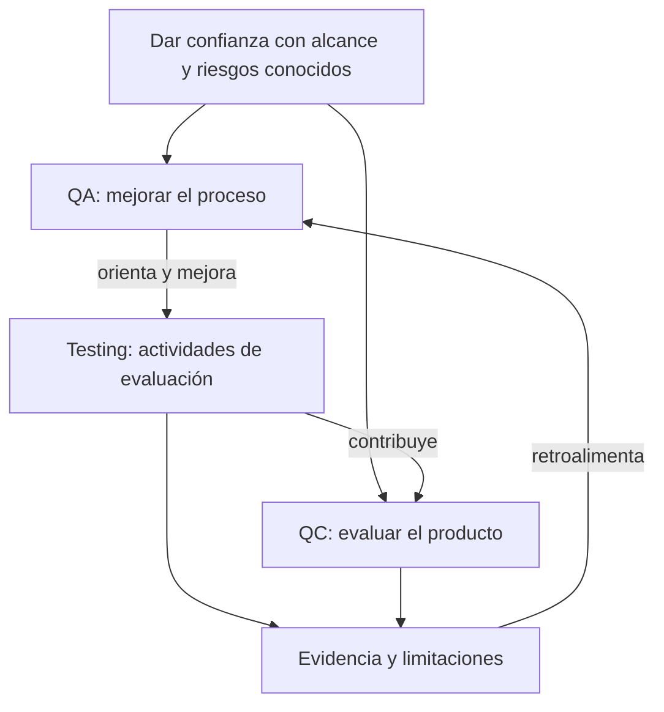
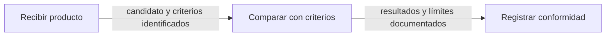

# W01-C01 — QA, QC y testing: conceptos diferentes

**Seguimiento posterior:** el usuario aprobó **todo W01-C01: ocho tarjetas y 24 fichas**. La propuesta editorial que sigue conserva su estado histórico G2; el alcance ahora implementado localmente, las decisiones y las pruebas diferidas se registran en el [acta](W01-C01-acta-implementacion-local.md) y la [entrega](W01-C01-entrega-local.md). No implica aprobación técnica ni despliegue.

> Módulo 01 · Fundamentos del Testing / semana 1 / `sections[0]` / HEAD `5dcbdf45b5b21b43d8f99ae01e0e62dbaa6c60c2` + árbol local descrito en G0. Versión editorial 0.1 · 2026-10-28. **PROPUESTO, NO IMPLEMENTADO.** Fuentes S01/S02/S03/S04 en [registro](00-baseline-y-fuentes.md).

## 01. Intención

Al terminar, el estudiante **clasificará una acción como QA, QC o testing, justificará su propósito y preparará una comparación esperado/obtenido sin deducir una causa no investigada**. Distinguirá además error, defecto, fallo, verificación y validación.

Audiencia: persona que comienza QA. Prerrequisitos: identificar entrada/resultado y hacer una resta o porcentaje sencillo; no requiere programar, conocer Scrum ni tener cuenta en un servicio externo. Se definen las siglas al utilizarlas.

Duración orientativa: 15–25 minutos, ajustable al estudiante. No se crea un límite de atención ni se cambia `guide.duration:25`; revisar la estimación de la semana completa antes de G3. Esta propuesta es una unidad editorial, no una práctica calificada adicional.

## 02. Comportamiento

### A. Gancho: un total que parece pequeño, un riesgo que no lo es

Brisa Tienda es un comercio ficticio. Durante un Sprint de dos semanas, el equipo prepara un cupón para una campaña. La versión candidata muestra **103.500 COP**, pero la regla acordada conduce a **104.500 COP**. Faltan horas para enseñar el incremento y todavía no sabemos en qué parte está la diferencia.

No estás usando la tienda real ni ejecutando el sandbox de QAPath: los datos, personas, builds, capturas y conversaciones siguientes son **material narrativo de entrenamiento**.

### B. Pregunta inicial: ¿qué harías como QA?

Antes de consultar la explicación, elige una respuesta y justifica una frase. Las consecuencias se muestran después de elegir; cambiar la elección está permitido.

| Opción | Respuesta | Feedback previsto |
|---|---|---|
| A | Declarar lista la versión porque los otros casos pasaron | El porcentaje no explica esta discrepancia ni la cobertura pendiente. No hay evidencia para ignorar la regla de importes |
| B | Calcular el esperado desde la regla, reproducir y comparar pantalla/respuesta, dejando versión y datos | **Mejor punto de partida.** Hace verificable la observación y permite investigar la diferencia sin inventar su causa |
| C | Cambiar el esperado a 103.500 para que el caso pase | El esperado procede de la regla acordada. Copiar el obtenido elimina la comprobación que necesitas |
| D | Afirmar de inmediato que el backend tiene una fórmula defectuosa | La pantalla demuestra un fallo observable. Aún falta localizarlo: puede estar en API, datos, presentación o en el propio esperado |

No hay envío automático, puntaje académico ni `reading-section` por seleccionar una opción. La explicación puede consultarse sin elegir.

### C. Caso conductor y oráculo independiente

**Historia ficticia BT-14:** «Como comprador quiero conocer el importe final al aplicar QA10 para decidir la compra antes de confirmar».

| Regla del ejemplo | Dato / esperado |
|---|---|
| Producto básico | 35.000 COP por unidad |
| Cantidad de este caso | 3 unidades; subtotal 105.000 COP |
| Elegibilidad | QA10 requiere subtotal mínimo de 100.000 COP |
| Descuento | 10 % del subtotal; 10.500 COP |
| Envío delivery | 10.000 COP; no participa en el descuento |
| Total | 105.000 − 10.500 + 10.000 = **104.500 COP** |
| Observación inicial ficticia | UI 103.500 COP; diferencia obtenido − esperado = **−1.000 COP** |

Estos criterios son de **esta historia**. La Definition of Done es un acuerdo de calidad del incremento; no es una copia de cada importe o criterio particular de la HU. Tampoco se convierte aquí la regla de cupón en una política universal de e-commerce.

**El equipo de la historia.** Ana es Product Owner; Lea tiene especialidad QA y forma parte de Developers junto a Diego, que trabaja en frontend. Nico, Scrum Master, facilita resolver impedimentos. QA, «tres amigos» y triage son prácticas/especialidades de este equipo, no accountabilities o eventos adicionales exigidos por Scrum. La calidad se comparte; no se entrega todo a una fase QA al final.

**Conversación tras la decisión inicial:**

> Lea: «Con los criterios calculo 104.500. Voy a guardar los datos y revisar qué devolvió la petición antes de localizar la causa».
>
> Ana: «Confirmo que el envío no recibe descuento y que el comprador debe conocer ese desglose antes de confirmar».
>
> Diego: «En esta reproducción, la respuesta de cotización trae 104.500, pero la pantalla vuelve a calcular el descuento sobre subtotal más envío. En la revisión de este frontend ficticio encuentro esa expresión; había interpretado mal la exclusión».
>
> Lea: «Documentemos el fallo y la evidencia de esa inspección. Después repetiremos el caso corregido y revisaremos variantes relacionadas. También llevemos a retrospectiva cómo mejorar la conversación sobre ejemplos».

La respuesta y la inspección son **revelaciones del relato**, no observaciones del código real de QAPath. Sin esa evidencia no se puede atribuir la causa. En el relato, `(105000 + 10000) × 0,9 = 103500` explica el cálculo UI incorrecto; la API del relato entrega el total correcto.

**Evidencias didácticas a producir, no adjuntos ya existentes:** E01: build `bt14-rc3`, entorno ficticio `QA-Brisa`, entradas y esperado calculado; E02: registro UI/response con datos depurados; E03: diferencia, caso reproducible, referencia a inspección y riesgo; E04: resultado de confirmación y regresión cuando se disponga de una corrección. E04 comienza **PENDIENTE**, nunca «pasó» por leer la explicación.

El equipo no declara el cambio Done mientras incumpla su Definition of Done. La recomendación de QA informa a quienes gobiernan la liberación; una aceptación de riesgo no reescribe silenciosamente los criterios o la DoD para presentar un incumplimiento como conformidad. Una alternativa de negocio sería posponer el cupón o usar un incremento anterior que sí cumpla sus acuerdos.

### D. Ocho tarjetas, una idea por foco

Se conservan **títulos, IDs y orden actuales**. Los textos siguientes son redacción propuesta, no reemplazo aplicado al JSON.

#### 1. Aseguramiento de calidad (QA) · `qa`

QA se orienta a mejorar procesos para prevenir problemas. En Brisa, acordar una revisión de ejemplos y seguir si reduce interpretaciones contradictorias es una acción de QA.

**Ejemplo:** el equipo incorpora la pregunta «¿qué importes participan en el descuento?» a su revisión de reglas. **Contraejemplo:** cambiar un esperado para ocultar un resultado incorrecto no mejora el proceso ni aporta confianza.

#### 2. Control de calidad (QC) · `qc`

QC evalúa el producto frente a características y criterios. Aquí contrasta el candidato, conserva discrepancias y comunica lo comprobado y lo pendiente.

**Ejemplo:** informar que el total incumple la regla y que el pago no se evaluó. **Contraejemplo:** «tres casos pasaron, por tanto todo está certificado». El testing contribuye al QC, pero los términos no son sinónimos.

#### 3. Testing · `testing`

Testing evalúa productos y otros artefactos para aportar información. Incluye actividades estáticas y dinámicas; no se limita a ejecutar una aplicación.

**Ejemplo:** revisar contradicciones del criterio y después ejecutar la cotización con datos conocidos. **Contraejemplo:** hacer clic sin comprobar ningún resultado. El caso dinámico compara 104.500 con 103.500 y conserva las condiciones de reproducción.

#### 4. Error · `error`

Es una acción humana equivocada. En el relato, la interpretación incorrecta se conoce por la conversación e inspección, no por adivinar quién tuvo la culpa.

**Ejemplo:** interpretar «descuento del subtotal» como «descuento también del envío». **Contraejemplo:** señalar a una persona solo porque la pantalla muestra un total diferente.

#### 5. Defecto · `defect`

Es una imperfección en un artefacto. En la inspección ficticia, la expresión de cálculo UI aplica el descuento a la base incorrecta.

**Ejemplo:** conservar esa expresión en el frontend. **Contraejemplo:** una captura del fallo sin investigar todavía el artefacto no demuestra dónde está el defecto.

#### 6. Fallo · `failure`

Es la desviación observable durante la ejecución: la pantalla muestra 103.500 cuando corresponde 104.500.

**Ejemplo:** reproducirla con cantidad, precio, cupón y envío registrados. **Contraejemplo:** la sospecha de que el pago podría duplicarse es un riesgo; sin observarlo no debe reportarse como un fallo ocurrido.

#### 7. Verificación · `verification`

Contrasta con requisitos o especificaciones. La regla de excluir el envío permite decidir si el cálculo cumple.

**Ejemplo:** revisar criterio y comparar importe. **Contraejemplo:** modificar la regla sin acuerdo para que cualquier resultado parezca conforme.

#### 8. Validación · `validation`

Contrasta si la solución satisface la necesidad de uso. Un cálculo correcto puede ser insuficiente si el comprador no entiende lo que pagará.

**Ejemplo:** observar si personas representativas comprenden subtotal, descuento y envío antes de confirmar. **Contraejemplo:** deducir utilidad solo del estado HTTP o de la fórmula correcta.

### E. Relaciones visuales

#### Grafo 1 — ¿Cómo se complementan QA, QC y testing?

**Alternativa textual completa:** el objetivo común es aportar confianza con límites explícitos. QA mejora el proceso y orienta cómo evaluar. Testing produce información que contribuye al QC; QC evalúa el producto. La evidencia y sus limitaciones retroalimentan las mejoras del proceso. Las flechas indican relación y feedback, no una jerarquía de personas ni una secuencia obligatoria de ceremonias.

#### Grafo 2 — ¿Qué hago para evaluar el candidato mediante QC?

**Alternativa textual completa:** primero se identifica el candidato, su contexto y alcance; después se comparan los resultados con criterios independientes; finalmente se comunican conformidades, incumplimientos y riesgos. «Registrar conformidad» conserva el título existente y **también registra la no conformidad**: no significa aprobar siempre. Rectángulos = etapas; flechas = transferencia de insumos/evidencias. Los tres nombres son exactamente los de `qc.demonstration.steps`.

En web se propone una lista ordenada semántica con conexiones CSS; en móvil, secuencia vertical. Los Mermaid son fuente editable de diseño, no una promesa de renderizado ya implementado ni diagramas BPMN formales.

### F. Globos QC completos: alcance candidato de implementación piloto

Estado inicial: **todos cerrados**. Cada bloque debe poder leerse por teclado/toque y en movimiento reducido. Los participantes descritos son posibles en esta historia.

#### Paso 1 / 3 — Recibir producto · `qc[0]`

**Objetivo:** identificar qué candidato y reglas serán evaluados.

1. Registra `bt14-rc3`, `QA-Brisa` y el alcance «cotización con QA10».
2. Confirma con negocio la exclusión del envío y el umbral de elegibilidad.
3. Prepara 3 unidades de 35.000 COP, QA10 y envío de 10.000 COP; calcula 104.500 antes de ejecutar.

**Entrada:** candidato identificado, BT-14, criterios y datos ficticios. **Participan:** Lea, Ana y Diego según necesidad. **Evidencia:** E01, versión, alcance y esperado independientes. **Error frecuente:** recibir «la última versión» sin un identificador comprobable.

#### Paso 2 / 3 — Comparar con criterios · `qc[1]`

**Objetivo:** demostrar qué comportamiento cumple o incumple el candidato.

1. Ejecuta la cotización con los datos de E01 y anota el resultado de pantalla.
2. Compara cada importe con el esperado; registra la diferencia de −1.000 COP.
3. Relaciona la acción con la respuesta ficticia de 104.500 y la UI de 103.500, depurando datos sensibles.
4. Conserva pasos, versión y observaciones separadas de hipótesis; solicita inspección para localizar la causa.

**Entrada:** E01 y criterios de cálculo/presentación. **Participan:** Lea y Diego. **Evidencia:** E02, **matriz de resultados y evidencias** con esperado/obtenido y relación UI/API. **Decisión:** reportar discrepancia, no modificar el esperado. No presentar Network simulado de este documento como captura real.

#### Paso 3 / 3 — Registrar conformidad · `qc[2]`

**Objetivo:** comunicar lo conforme, lo no conforme y la incertidumbre restante.

1. Resume el criterio incumplido, las comprobaciones realizadas y lo no ejecutado; no inventes el resultado del pago.
2. Relaciona el reporte con BT-14, E01/E02 y el resultado de inspección aportado por desarrollo.
3. Recomienda corregir y repetir el caso; propone regresión sin cupón y con recogida cuando exista una versión corregida.
4. Comunica riesgos y alternativas a los responsables; registra E04 como pendiente hasta ejecutarlo.

**Entrada:** resultados, discrepancias y limitaciones. **Participan:** Lea, Ana y equipo de entrega. **Evidencia:** E03, informe de evaluación con riesgos residuales; E04 pendiente. **Error frecuente:** convertir «no lo probé» en «aprobado» o tratar QA como quien certifica unilateralmente la liberación.

### G. Detalles editoriales de los otros siete conceptos

Estos 21 globos completan el **diseño editorial del capítulo**, no amplían automáticamente G4. Se recomienda implementar primero los tres de QC; el resto requiere alcance explícito en G3/lote siguiente. Cada celda de acciones conserva orden 1→2 y tiene dos acciones concretas. Sus entradas/evidencias son artefactos didácticos por producir.

En `error`, `defect` y `failure`, la secuencia **describe una cadena causal del ejemplo**, no un procedimiento aconsejado para introducir errores en un producto real.

| Concepto / paso y título existente | Objetivo del globo | Acciones ordenadas | Entrada → evidencia | Participación posible / cuidado |
|---|---|---|---|---|
| qa 1 · Detectar problema recurrente | Reconocer un patrón investigable | 1. Reúne las dos discrepancias ficticias de cupones. 2. Separa hechos de explicaciones aún no contrastadas | Reportes depurados → patrón y límites anotados | Equipo; no culpar por una captura |
| qa 2 · Mejorar el proceso | Acordar una mejora preventiva | 1. Propón revisar ejemplos de base de descuento. 2. Acuerda quién registra y revisa ese acuerdo | Patrón → propuesta de mejora | Equipo; no copiar la HU entera a la DoD |
| qa 3 · Prevenir nuevos defectos | Revisar el efecto de la mejora | 1. Aplica la revisión en la siguiente regla. 2. Compara dudas detectadas y retrabajo observado | Acuerdo → seguimiento de mejora | Equipo; no garantizar cero defectos |
| testing 1 · Preparar caso y datos | Crear una comparación válida | 1. Identifica el criterio de envío sin descuento. 2. Registra datos y 104.500 como esperado | BT-14 → caso y oráculo | Lea; no tomar la UI como oráculo |
| testing 2 · Ejecutar la prueba | Observar el comportamiento | 1. Usa el candidato identificado. 2. Guarda acción, pantalla y respuesta del relato | Caso → E02 | Lea; datos ficticios |
| testing 3 · Comparar esperado y obtenido | Explicar una diferencia | 1. Contrasta 104.500 y 103.500. 2. Registra −1.000 y el alcance del caso | E01/E02 → discrepancia reproducible | Lea/Diego; no declarar causa sin inspección |
| error 1 · Leer una regla | Comprender el acuerdo | 1. Lee qué base recibe el 10 %. 2. Identifica la exclusión explícita del envío | Criterio → interpretación escrita | Ana/equipo |
| error 2 · Interpretarla mal | Reconocer el equívoco del relato | 1. Contrasta «incluye envío» con el criterio. 2. Señala qué exclusión se omitió | Interpretación del relato → diferencia explicada | Diego/Lea; no pedir introducir errores reales |
| error 3 · Aclarar con evidencia | Resolver la ambigüedad | 1. Muestra ambos cálculos a negocio. 2. Registra el acuerdo correcto y su ejemplo | Cálculos → decisión trazable | Ana/equipo |
| defect 1 · Regla de negocio | Establecer la referencia | 1. Identifica subtotal y envío por separado. 2. Escribe el total esperado antes de inspeccionar código | BT-14 → fórmula esperada | Lea/Diego |
| defect 2 · Fórmula incorrecta | Localizar un artefacto defectuoso | 1. Inspecciona la fórmula UI ficticia aportada. 2. Muestra dónde el envío entra indebidamente en la base | Inspección del relato → expresión localizada | Diego; no asumir fallo de API |
| defect 3 · Defecto identificado | Vincular defecto y regla | 1. Relaciona expresión y criterio incumplido. 2. Propón repetir el mismo caso después de corregir | Regla/inspección → reporte enlazado | Equipo; corrección aún no ejecutada |
| failure 1 · Ejecutar datos concretos | Reproducir el síntoma | 1. Prepara 3 unidades y QA10. 2. Solicita la cotización con envío | E01 → ejecución identificada | Lea |
| failure 2 · Observar 103500 COP | Describir lo sucedido | 1. Anota 103.500 como obtenido. 2. Conserva versión y contexto de esa pantalla | Ejecución → registro de observación | Lea; distinguir relato de ejecución real |
| failure 3 · Contrastar con 104500 COP | Demostrar el incumplimiento | 1. Compara con el cálculo de E01. 2. Describe diferencia y condición reproducible | Observación/oráculo → fallo documentado | Lea; fallo no identifica por sí solo una persona |
| verification 1 · Consultar especificación | Definir qué se comprueba | 1. Localiza la exclusión del envío. 2. Confirma alcance y datos de BT-14 | Criterios → referencia de verificación | Ana/Lea |
| verification 2 · Comprobar implementación | Reunir evidencia de conformidad | 1. Compara el resultado con el criterio. 2. Anota cumplimientos e incumplimientos por separado | Caso → comparación por criterio | Lea/Diego |
| verification 3 · Evaluar conformidad | Emitir una conclusión limitada | 1. Indica qué criterio incumple la UI. 2. Declara qué no fue comprobado | Resultados → conclusión de alcance | Equipo; no garantía global |
| validation 1 · Observar necesidad | Entender la decisión del comprador | 1. Pregunta qué necesita saber antes de confirmar. 2. Registra dudas sobre costo total | Necesidad → hipótesis de uso | Ana/personas representativas |
| validation 2 · Probar con usuarios | Observar comprensión | 1. Presenta el desglose ficticio sin explicar la respuesta. 2. Pide interpretar cuánto se pagará | Prototipo/datos → notas de comprensión | Facilitación; consentimiento y datos ficticios |
| validation 3 · Validar utilidad | Contrastar solución y necesidad | 1. Compara comprensión con el objetivo acordado. 2. Propón y vuelve a evaluar una mejora | Observaciones → conclusión y siguiente paso | Equipo; un usuario no representa a todos |

### H. Microactividad: arma un reporte que pueda usar el equipo

**Entrada visible:** BT-14 y los datos de la tabla. Todavía no existe una corrección evaluada. Ordena las tres etapas QC y elige qué registrar. La interfaz futura puede ofrecer tres botones por decisión y «Ver explicación»; el documento muestra todo para revisión editorial.

| Decisión | Elecciones y feedback |
|---|---|
| 1. Base del descuento | **Subtotal 105.000:** correcto, la regla excluye envío. **Total con envío 115.000:** incluirlo produce 103.500 final, contradice el criterio. **103.500 observado:** no es la base del descuento ni un oráculo |
| 2. Evidencia de la diferencia | **Esperado/obtenido + entradas/build + respuesta/pantalla:** permite contrastar y reproducir. **Solo captura:** omite condiciones. **Cambiar esperado:** borra el desacuerdo en vez de evaluarlo |
| 3. Estado del caso después de leer este capítulo | **Discrepancia documentada; confirmación pendiente:** correcto. **Defecto corregido y probado:** no existe evidencia de esa ejecución. **Versión aprobada automáticamente:** leer o abrir globos no evalúa el candidato |

**Respuesta modelo:** «Para `bt14-rc3`, 3 × 35.000 con QA10 y delivery debe producir 104.500 COP. La observación ficticia es 103.500; la respuesta del relato es 104.500. Registro −1.000 en UI y la evidencia de inspección que aporta desarrollo. Recomiendo corregir, confirmar con los mismos datos y ejecutar regresión relacionada; no marco la confirmación como realizada».

**Criterio formativo:** justificar el oráculo, conservar contexto, separar observación/causa y declarar pendientes. Si falta uno, explicar qué evidencia lo resolvería y permitir reintento. No se persiste nota/calificación ni se reemplaza la autoevaluación de la semana.

### I. Transferencia: otro producto, el mismo razonamiento

Una plataforma de reservas cumple la regla escrita, pero las personas no entienden cuándo queda confirmada la reserva. No hay importes ni cupones.

1. ¿Qué acción propones de validación? **Modelo:** observar comprensión con personas representativas y comparar con la necesidad de saber si existe una reserva confirmada.
2. ¿Qué comprobarías por verificación? **Modelo:** respuesta y estado de reserva frente al criterio documentado.
3. ¿Qué mejora de proceso discutirías? **Modelo:** incluir ejemplos de confirmación y ausencia de disponibilidad en la revisión temprana. Es propuesta contextual, no ceremonia Scrum nueva.

### J. Cierre y recuperación activa

QA mejora cómo trabajamos; QC evalúa el producto; testing aporta información a esa evaluación. Un resultado incorrecto se describe antes de atribuir una causa. Verificar una regla y validar utilidad son preguntas complementarias.

**Error frecuente:** aprobar por un porcentaje global o presentar una hipótesis como defecto localizado. **Recupera sin mirar:** ¿qué dato te falta si solo recibes una captura? ¿por qué 104.500 no debe calcularse leyendo el valor actual? ¿qué evidencia permite distinguir fallo UI y error de API? Respuesta orientativa: contexto/oráculo; independencia del esperado; comparación e inspección trazables.

**Glosario práctico:** build = versión identificada; HU = historia de usuario; CA = criterio de aceptación; oráculo = referencia para decidir el esperado; DoD = Definition of Done, acuerdo de calidad del incremento; riesgo residual = incertidumbre que permanece después de las acciones realizadas.

Referencias: [CTFL 4.0.1, §§1.1–1.3](https://istqb.org/?download_id=3345&sdm_process_download=1) y [Scrum Guide noviembre 2020](https://scrumguides.org/scrum-guide.html), consultadas 2026-10-28. ISO 25010:2023/29119-1:2022 se usan solo como contexto bibliográfico de ficha pública, sin atribuirles la plantilla del relato. Toda la historia, cálculos, actividades y diagramas son redacción propia; no reproducción de material de un curso externo.

## 03. Restricciones

- Conservar los ocho IDs/títulos y sus 24 nombres de nodo. No cambiar el ejemplo guiado bancario posterior, la práctica 1, Gherkin, los hashes, la descarga o las reglas académicas al aprobar solo QC.
- Globos y microactividad son apoyo, no condición para avanzar. No ejecutar solicitudes ni enviar preguntas a MariBug por abrirlos.
- Ni E01–E04 ni los porcentajes del caso son resultados de una ejecución real. E04 y toda prueba de accesibilidad siguen pendientes.
- El contrato [de globos](00-contrato-grafos-y-globos.md) gobierna foco, scroll, pausa, fallback y D1. No añadir UI auxiliar a la referencia pasiva sin validar su efecto.

## 04. No-Objetivos

No enseñar una política completa de contraseñas, certificar seguridad, imponer un proceso Scrum, sustituir el laboratorio de transferencias, entregar una suite ejecutada ni autorizar release.

## Criterios de aceptación y trazabilidad

| ID local | Dado / Cuando / Entonces propuesto | Evidencia prevista | Estado |
|---|---|---|---|
| ED-01 | Dado BT-14, al calcular independiente, el estudiante explica 104.500 y −1.000 | Justificación de microactividad | Diseñado; no probado |
| ED-02 | Al clasificar revisar proceso/evaluar candidato/ejecutar caso, diferencia propósitos | Respuesta explicada, no solo etiqueta | Diseñado |
| ED-03 | Al consultar qc[1], obtiene exactamente el paso 2 y E02 | Mapeo explícito índice → globo | Diseñado |
| ED-04 | Al cerrar/abrir detalles, no se crean logros, notas ni pruebas ejecutadas | Comparación futura de estado estable | Pendiente de implementación |
| ED-05 | Al usar teclado/toque/reduced, puede consultar el mismo contenido | Revisión futura manual y automatizada | Pendiente |
| ED-06 | Al transferir a reservas, distingue necesidad y especificación | Explicación en contexto nuevo | Diseñado |

## Rúbrica editorial y aprobación

Usar las ocho dimensiones de CONTENT-210: exactitud, resultado observable, caso de equipo, legibilidad, grafo, acciones por estado, microinteracción e inclusión/accesibilidad. Cada una vale 0–2; umbral para proponer aceptación 14/16, sin 0 en exactitud, objetivo o accesibilidad. Es rúbrica del contenido, no nueva calificación del alumno.

| Dimensión | Evidencia diseñada | Qué falta para asignar 2 |
|---|---|---|
| Exactitud técnica, crítica | S01/S02, cálculos y distinciones | Firma QA independiente |
| Objetivo observable, crítica | Clasificación y reporte razonado | Revisión docente de evaluación |
| Caso de equipo | BT-14, actores, conversación y consecuencia | Revisión de realismo |
| Legibilidad | Ocho focos y bloques bajo demanda | Sesión con estudiantes |
| Grafo significativo | Dos Mermaid con equivalentes textuales | Revisión de lectura/representación final |
| Acciones por estado | 24 fichas; tres QC detalladas | Revisión de correspondencia editorial |
| Microinteracción | Feedback por opción y transferencia | Implementación aprobada y observación de uso |
| Inclusión/accesibilidad, crítica | Contrato teclado/toque/reduced/alternativas | Validación final real; no puntuar conformidad por este Markdown |

**Puntaje no asignado**: propuesta completa no equivale a una prueba de comprensión o accesibilidad. QA técnico, revisión pedagógica, UX/accesibilidad y aprobación de implementación: **PENDIENTES**. La aprobación G3 debe distinguir QC piloto de los otros siete conceptos propuestos.
