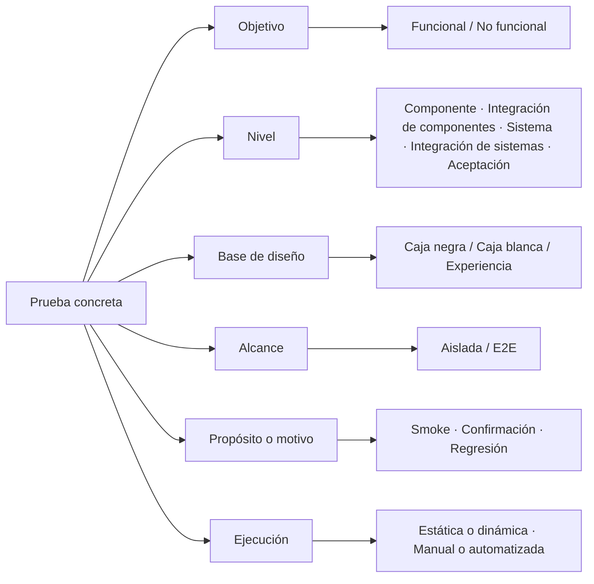
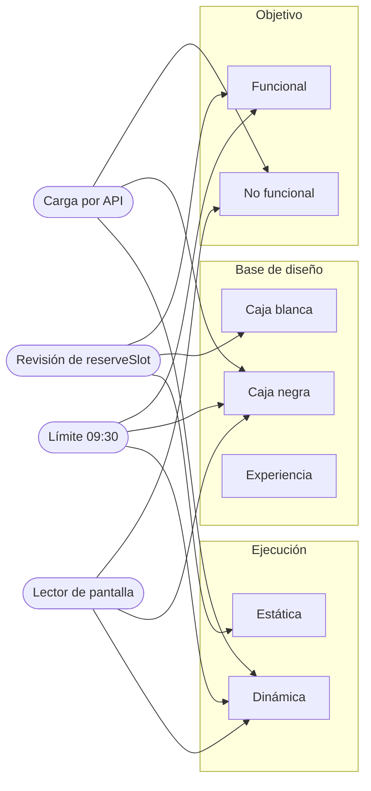
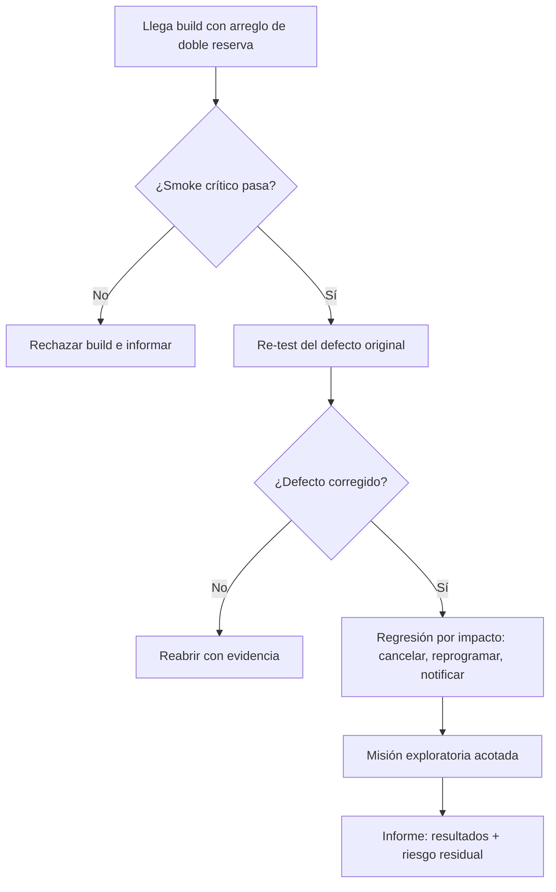
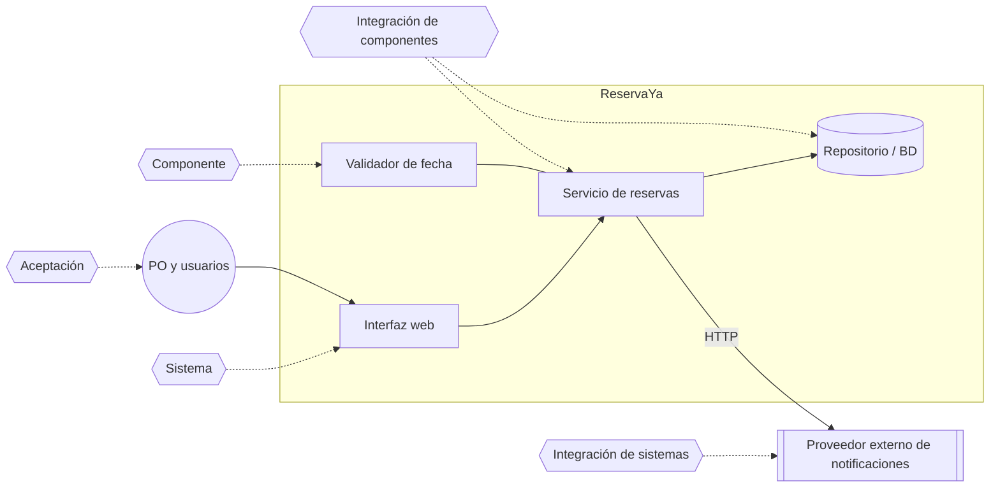
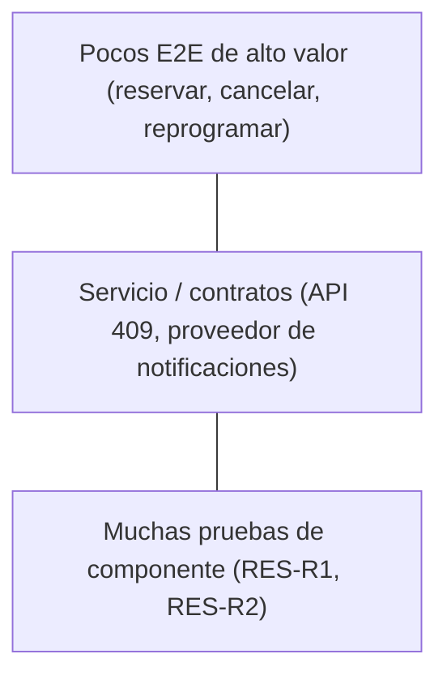
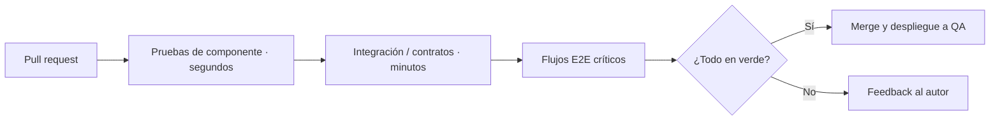
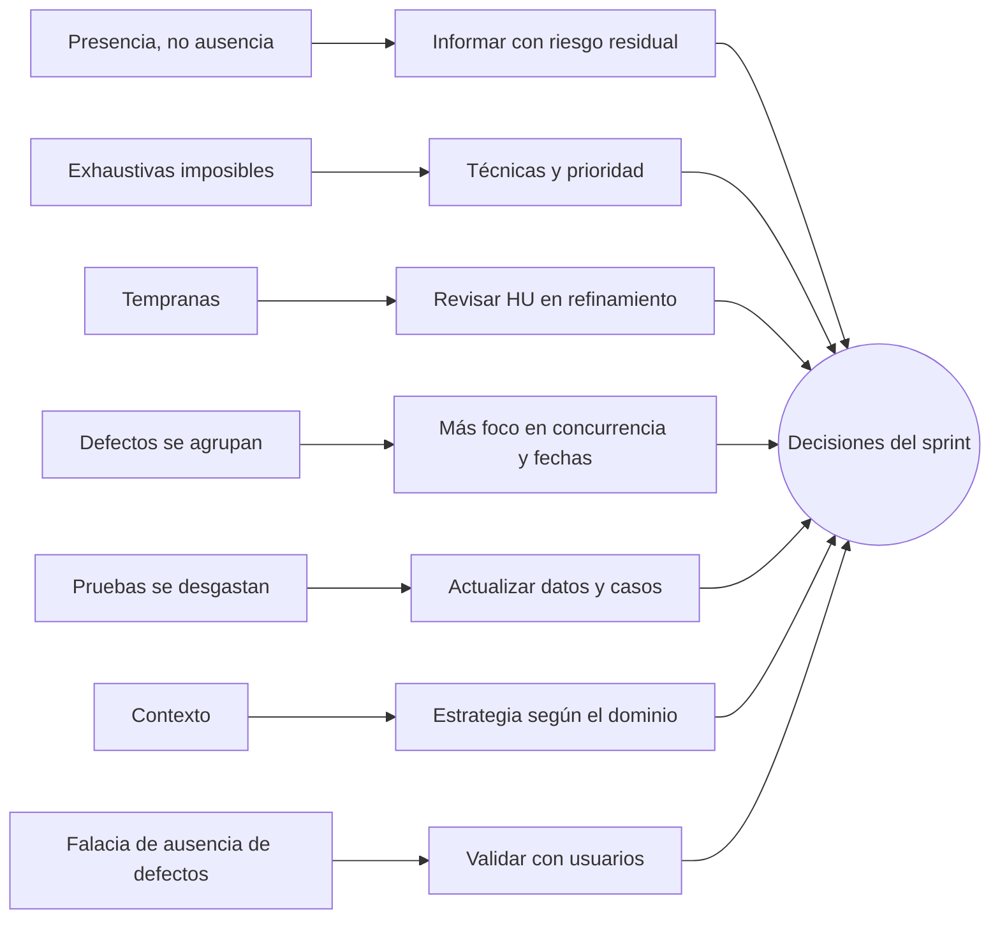
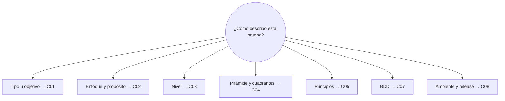
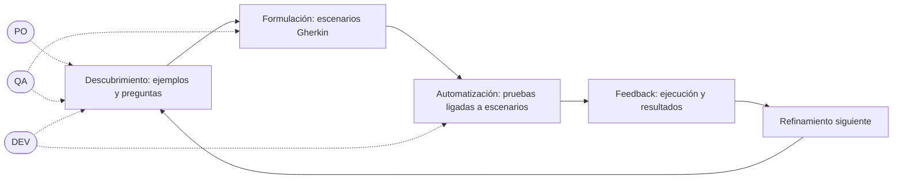
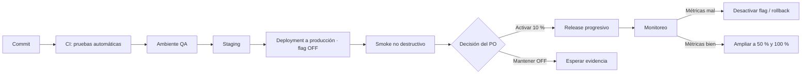

# 05 · Grafos y demostraciones «Así se aplica»

Fase G1–G2 · solo documentación · 2026-10-29

**Reglas comunes:**

- Mermaid es la **fuente** versionable. Se valida con `mmdc` y se muestra como SVG pregenerado o como lista estructurada (D-08). Nunca se ejecuta en el navegador.
- Cada diagrama tiene una alternativa textual equivalente.
- Los globos salen únicamente de la tabla editorial aprobada (SPEC §2.6). El frontend no inventa ni genera texto.
- Abrir un globo **no** emite comandos de progreso (AC-16).

---

## Grafo general · una prueba, varios ejes (C01–C03, C06)



**Alternativa textual:** una prueba concreta se describe con seis ejes independientes: objetivo (funcional o no funcional); nivel (los cinco del CTFL); base de diseño (caja negra, caja blanca o experiencia); alcance (aislada o E2E); propósito (smoke, confirmación o regresión); y ejecución (estática o dinámica, manual o automatizada). Elegir un valor en un eje no determina los demás.

---

## C01 · Tipos: tres ejes combinables



**Alternativa textual:**

- Carga por API → no funcional, caja negra, dinámica.
- Revisión del código de `reserveSlot` → funcional, caja blanca, estática.
- Valor límite 09:30 → funcional, caja negra, dinámica.
- Lector de pantalla → no funcional, caja negra, dinámica.

**Globos C01 · «Clasificar una prueba antes del sprint»** (detalle en 03 §6)

| # | Estado | Acciones | Responsable posible | Evidencia |
|---|---|---|---|---|
| 1 | Leer la intención | Identificar la regla o característica · preguntar qué riesgo cubre | QA con PO | Regla RES-Rn o característica 25010 |
| 2 | Elegir la base de diseño | Especificación, estructura o experiencia · elegir la técnica | QA y DEV | Técnica anotada |
| 3 | Decidir cómo evaluar | Revisión o ejecución · elegir el ambiente | Equipo | Evidencia esperada definida |

---

## C02 · Árbol de decisión tras un arreglo



**Alternativa textual:**

1. Llega la build con el arreglo. Si el smoke crítico falla, se rechaza y se informa.
2. Si el smoke pasa, se hace el re-test del defecto original. Si el defecto persiste, se reabre con evidencia.
3. Si está corregido, se ejecuta la regresión según el impacto (cancelar, reprogramar y notificar) y una misión exploratoria acotada.
4. Se cierra con un informe de resultados y riesgo residual.

**Globos C02 · «Probar un arreglo con poco tiempo»**

| # | Estado | Acciones | Responsable posible | Evidencia |
|---|---|---|---|---|
| 1 | Smoke | Ejecutar 3 comprobaciones críticas · decidir si seguir | QA (puede automatizarse) | Informe del smoke con build y hora |
| 2 | Re-test | Repetir los pasos del reporte · usar los mismos datos | QA | Reporte con el resultado del re-test |
| 3 | Regresión | Elegir las zonas afectadas · ejecutar la suite seleccionada | QA y DEV | Resultados de la regresión |
| 4 | Informar | Resumir los resultados · declarar lo no probado | QA con PO | Riesgo residual escrito |

---

## C03 · Cinco niveles sobre la arquitectura de ReservaYa



**Alternativa textual:**

- ReservaYa tiene interfaz, servicio de reservas, validador de fecha y repositorio, y se comunica por HTTP con un proveedor externo de notificaciones.
- **Componente:** el validador de fecha aislado.
- **Integración de componentes:** el servicio con el repositorio, ambos dentro de ReservaYa.
- **Sistema:** la aplicación completa desde la interfaz.
- **Integración de sistemas:** ReservaYa con el proveedor externo.
- **Aceptación:** el PO y los usuarios validan que resuelve su necesidad.

En la versión SVG, las dos integraciones se distinguen por color **y** por etiqueta de texto. El color nunca es la única señal (06 §2).

**Globos C03 · Integración de sistemas (ejemplo obligatorio del SPEC §2.6)**

| # | Estado | Acciones | Responsable posible | Evidencia |
|---|---|---|---|---|
| 1 | Preparar integración | Revisar el contrato externo · simular la respuesta 503 · definir el resultado esperado | DEV y QA | Contrato y datos ficticios |
| 2 | Ejecutar intercambio | Enviar la solicitud · comprobar el reintento · inspeccionar la respuesta | QA | Traza anonimizada |
| 3 | Evaluar recuperación | Confirmar que el estado de la reserva es consistente · registrar la incidencia o la conformidad | Equipo | Resultado y riesgo residual |

---

## C04 · Pirámide y flujo del PR





**Alternativa textual (lista ordenada de la pirámide):**

1. Base: muchas pruebas de componente para las reglas puras.
2. Medio: pruebas de servicio y contratos.
3. Cima: pocos E2E de alto valor.

**Flujo:** el PR ejecuta primero las pruebas de componente, después las de integración y contratos, y por último los E2E críticos. Si todo pasa, se hace merge y despliegue a QA; si no, el autor recibe el feedback. No hay proporciones obligatorias.

**Globos C04 · «Rebalancear la suite»**

| # | Estado | Acciones | Responsable posible | Evidencia |
|---|---|---|---|---|
| 1 | Medir | Contar las pruebas por capa · medir tiempos y fallos intermitentes | QA Automation y DEV | Tabla del estado actual |
| 2 | Mover | Pasar las reglas puras a componente · las interacciones, a contratos | DEV con QA | PRs con las pruebas movidas |
| 3 | Conservar | Dejar pocos E2E críticos · revisar su estabilidad | QA | Lista de recorridos críticos |
| 4 | Verificar | Comparar el tiempo de feedback antes y después | Equipo | Métrica antes y después |

---

## C05 · Principios conectados a decisiones



**Alternativa textual:** cada principio lleva a una decisión. Presencia → informar con riesgo residual. Exhaustivas → técnicas y prioridad. Tempranas → revisar la HU en refinamiento. Agrupación → foco en concurrencia y fechas. Desgaste → actualizar los datos y casos. Contexto → estrategia según el dominio. Falacia → validar con usuarios. Todas alimentan las decisiones del sprint. **El orden no es una secuencia.**

**Globos C05 · «Aplicar principios en el sprint»**

| # | Estado | Acciones | Responsable posible | Evidencia |
|---|---|---|---|---|
| 1 | Refinamiento | Revisar la HU (tempranas) · elegir técnicas (exhaustivas) | Equipo | Comentarios en la HU |
| 2 | Desarrollo | Enfocar las zonas con más defectos (agrupación) · renovar los datos (desgaste) | QA y DEV | Suite actualizada |
| 3 | Antes de liberar | Informar sin prometer «cero errores» (presencia) · validar el valor (falacia) | QA con PO | Informe y feedback de usuarios |

---

## C06 · Mapa de dudas enlazado a capítulos



**Alternativa textual:** la pregunta «¿cómo describo esta prueba?» se responde por partes:

- el tipo (C01),
- el enfoque y el propósito (C02),
- el nivel (C03),
- la cartera (C04),
- los principios que justifican la decisión (C05),
- la especificación con ejemplos (C07),
- el ambiente y el release (C08).

**Globos C06 · «Clasificar un escenario ambiguo»**

| # | Estado | Acciones | Responsable posible | Evidencia |
|---|---|---|---|---|
| 1 | Separar ejes | Leer el escenario · identificar las palabras de cada eje | QA | Etiquetas anotadas |
| 2 | Resolver condiciones | Preguntar «¿pertenece al subconjunto crítico?» · decidir smoke sí o no | QA con equipo | Justificación escrita |
| 3 | Registrar | Guardar la clasificación en el plan o la suite | QA | Plan actualizado |

---

## C07 · Ciclo BDD con roles



**Alternativa textual:** el ciclo BDD tiene cuatro momentos, y vuelve al descubrimiento en el siguiente refinamiento.

1. **Descubrimiento**, con ejemplos y preguntas. Participan el PO, QA y DEV.
2. **Formulación**, con escenarios Gherkin. Participan QA y el equipo.
3. **Automatización**, con pruebas ligadas a los escenarios. La hace DEV o QA Automation.
4. **Feedback**, con los resultados de la ejecución.

**Escenario de ejemplo** (bloque de código con nombre accesible «Ejemplo reservas.feature»):

```gherkin
# language: es
Característica: Reserva exclusiva de turnos

  Regla: Un turno no puede confirmarse para dos personas

    Escenario: Evitar doble reserva del mismo turno
      Dado que el turno del martes a las 10:00 está disponible
      Y que Ana y Luis han iniciado sesión
      Cuando ambos confirman la reserva casi al mismo tiempo
      Entonces solo una reserva queda confirmada
      Y la otra persona recibe un mensaje de conflicto
```

**Globos C07 · «De la conversación al escenario»**

| # | Estado | Acciones | Responsable posible | Evidencia |
|---|---|---|---|---|
| 1 | Descubrir | Enunciar la regla · proponer ejemplo y contraejemplo · anotar preguntas | PO, QA, DEV | Tarjetas de la conversación |
| 2 | Formular | Escribir Dado/Cuando/Entonces · revisar la ambigüedad | QA con PO | Archivo `.feature` revisado |
| 3 | Automatizar | Conectar los pasos · controlar la concurrencia y los datos | DEV y QA Automation | Prueba reproducible |
| 4 | Retroalimentar | Ejecutar · compartir el resultado · ajustar la regla | Equipo | Informe de ejecución |

---

## C08 · Recorrido de despliegue y release (varía por organización)



**Alternativa textual:**

1. El commit pasa por CI, el ambiente QA y staging, y se despliega a producción con el flag desactivado.
2. Tras un smoke no destructivo, el PO decide: activar el flag para el 10 % (release progresivo) o mantenerlo OFF mientras espera más evidencia.
3. Tras activarlo se monitorea. Si las métricas empeoran, se desactiva el flag o se hace rollback; si son buenas, se amplía al 50 % y luego al 100 %.

La ruta exacta depende de cada organización.

**Globos C08 · «Del deployment al release»**

| # | Estado | Acciones | Responsable posible | Evidencia |
|---|---|---|---|---|
| 1 | Desplegar con flag OFF | Verificar la versión · comprobar la configuración del flag | DevOps | Registro del pipeline |
| 2 | Smoke post-deployment | Ejecutar comprobaciones no destructivas · revisar los logs | QA y DevOps | Resultado con hora |
| 3 | Decidir release | Revisar evidencia, defectos y métricas · elegir el porcentaje | PO con equipo | Acta de la decisión |
| 4 | Monitorear o revertir | Observar errores y conflictos · desactivar si se supera el umbral | DevOps y QA | Panel de métricas y registro del cambio |

---

## Inventario

| Cap. | Diagramas | Estados con globo |
|---|---|---|
| General | 1 | — |
| C01 | 1 | 3 |
| C02 | 1 | 4 |
| C03 | 1 | 3 |
| C04 | 2 | 4 |
| C05 | 1 | 3 |
| C06 | 1 | 3 |
| C07 | 1 + escenario Gherkin | 4 |
| C08 | 1 | 4 |
| **Total** | **10 Mermaid** | **28 estados** |
