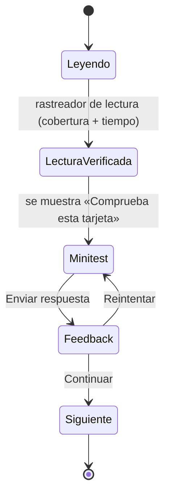

# 06 · Interacciones, minitests y accesibilidad

Fase G1–G2 · solo documentación · 2026-10-29 · Objetivo de accesibilidad: WCAG 2.2 AA (F07). No se afirma conformidad sin una auditoría.

## 1. Recorrido de estudio de una tarjeta

**Alternativa textual:** una tarjeta se lee hasta que el rastreador verifica cobertura y tiempo. Entonces aparece su minitest. Al enviar la respuesta se muestra el feedback; se puede reintentar o continuar a la siguiente tarjeta.

- **Una tarjeta principal a la vez**, con «← Anterior» y «Siguiente →», un índice accesible del capítulo y reanudación en la última tarjeta (AC-12). Se reutiliza la mecánica del modo enfocado (SPEC-UX-120).
- «Siguiente» **no está bloqueado** por el minitest: el alumno puede avanzar y volver. Lo que exige el minitest es la completitud académica (D-05).
- Notas, descarga y MariBug siguen disponibles como herramientas del estudio. MariBug sale de la vista de módulo (RQ-03), pero se mantiene en el estudio.

## 2. Globos por estado: matriz de interacción (AC-13, AC-14, AC-15)

| Entrada | Comportamiento | Criterio WCAG |
|---|---|---|
| Mouse | `hover` sobre el nodo abre su globo. El globo sigue abierto mientras el puntero esté en el nodo o en el globo, y se cierra a los 300 ms de salir de ambos | 1.4.13 (AA): descartable, *hoverable* y persistente |
| Teclado | Cada nodo es un `<button aria-expanded aria-controls>` alcanzable con `Tab`. `Enter`/`Espacio` fijan o sueltan el globo · `Escape` cierra y devuelve el foco al nodo · las flechas ←/→ pasan al estado anterior o siguiente | 2.1.1, 2.4.7, 4.1.2 |
| Touch | Un toque abre el globo; tocar otro nodo cambia de estado; el botón «Cerrar» o volver a tocar el nodo lo cierra. No depende de `hover` | 2.5.8 (AA): objetivo ≥ 24×24 px |
| Scroll | Un `IntersectionObserver` (umbral 0,6) más 400 ms de estabilidad abren el globo del **estado activo una sola vez** por visita a la tarjeta. No mueve el foco ni repite aperturas al desplazarse | 2.2.1, 2.4.11 (AA): el foco no queda oculto |
| Animación | La línea de avance entre estados se puede pausar. Se detiene mientras un globo está abierto. Con `prefers-reduced-motion` no hay animación y todos los estados se muestran como lista ordenada | 2.2.2, 2.3.3 (AAA, deseable) |
| Exclusividad | Un solo globo abierto por demostración | — |
| Posición | Desde 768 px es un *popover* que no cubre el texto de la tarjeta ni sale del viewport. Por debajo de 768 px es un panel bajo el flujo (`aria-live="polite"`) | 1.4.10 (reflujo a 320 px) |
| Contenido | Título del estado, acciones (lista), responsable posible, evidencia y resultado. Todo proviene de los datos editoriales | — |
| Progreso | **Ningún evento de globo emite comandos de progreso** | AC-16 |

## 3. Minitest por tarjeta (RQ-05, D-04, D-05)

### 3.1 Experiencia

| Aspecto | Regla |
|---|---|
| Aparición | Bloque «Comprueba esta tarjeta» al final de la tarjeta, **después** de que el rastreador verifique la lectura. Antes aparece como «Disponible al terminar la lectura» (sin ocultar el texto) |
| Formato | 1–2 preguntas de opción única (radio), 3 opciones con distractores basados en confusiones típicas (04) |
| Envío | Botón «Comprobar». Las respuestas correctas **no viajan al cliente** antes de enviar (mismo patrón que `PublicQuestion`) |
| Feedback | Inmediato: ✓/✗ con texto, no solo color. Explica por qué la opción elegida es correcta o no y cuál era la idea clave. Se anuncia con `role="status"` |
| Reintento | Ilimitado. Cuenta el **mejor resultado** por pregunta. Al reintentar se barajan las opciones |
| Estado visible | En la tarjeta: «Minitest aprobado ✓» o «Pendiente». En el índice del capítulo: x/N preguntas correctas |
| Cierre del capítulo | Resumen: «x/N correctas · Capítulo aprobado (≥ 70 %)» o «Te faltan k: repasa T03 y T05», con enlaces a esas tarjetas |
| Invitados | La corrección se hace en el navegador con los datos públicos de feedback y el resultado se guarda en local. Al iniciar sesión **no se importa como aprobado**: se pide repetir el minitest, igual que hoy no se confía en las notas importadas |
| Sin tiempo límite | No hay cronómetro (2.2.1) |

### 3.2 Reglas académicas

- El minitest de una tarjeta solo puntúa si su lectura está verificada, para que no se pueda aprobar sin leer.
- Capítulo aprobado = ⌈0,7 × preguntas⌉ correctas (tabla en 04).
- Semana de Fundamentos completa = todas sus tarjetas leídas + sus 4 capítulos aprobados + práctica validada.
- Abrir globos, hacer clics en la interacción, recorrer tarjetas o cambiar de pestaña **no** suma (AC-16).

## 4. Interacciones de capítulo

Todas son **formativas**: no puntúan ni emiten evidencia académica.

| Cap. | Interacción | Modo principal | Alternativa sin arrastrar (2.5.7, AA) | Feedback |
|---|---|---|---|---|
| C01 | Clasificador de 6 pruebas en 3 ejes | Selectores por eje | Ya es por selección | Por eje, explicativo |
| C02 | Simulador «tienes 30 minutos» | Casillas con costo en minutos | — | Por elección + riesgo residual. Se aceptan alternativas justificadas |
| C03 | Asignar 7 ejemplos a un nivel | Arrastrar a una columna | Lista de selección «Nivel» por ejemplo | Con matices de contexto |
| C04 | Distribuir 12 escenarios por capa y rol | Arrastrar | Dos selectores (capa, participación) | Muestra la responsabilidad compartida |
| C05 | 7 microescenarios | Opción única | — | Por qué las otras opciones son peores |
| C06 | Clasificador multidimensional | Casillas múltiples por eje | — | Explica las etiquetas condicionales |
| C07 | Constructor de Gherkin | Arrastrar líneas | Botones «Subir/Bajar» por línea | Detecta ambigüedad y orden |
| C08 | Release o rollback (3 rondas) | Opción + justificación | — | Valora la justificación |

Para todas: foco visible, no depender del color, anuncios con `aria-live` y objetivos táctiles de al menos 24 px.

## 5. Estado local de las interacciones

Las elecciones formativas se guardan como borrador local, con la clave `qapath:fnd:v2:<usuario|guest>:<capítulo>`. El botón «Reiniciar actividad» borra solo ese borrador y nunca notas, minitests ni progreso. Si el almacenamiento falla, la actividad funciona sin persistencia y muestra un aviso discreto.

## 6. Rúbricas de entregables (formativas)

| Entregable | Criterios (cumple / parcial / no cumple) |
|---|---|
| C01 Tabla de 6 pruebas | 3 ejes por fila · al menos 1 no funcional, 1 estática y 1 de caja blanca · evidencia concreta |
| C02 Mini plan | Smoke + re-test + regresión con objetivos distintos · misión exploratoria con tiempo · riesgo residual |
| C03 Matriz de niveles | 5 niveles · dos integraciones diferenciadas · responsables no exclusivos |
| C04 Suite | Al menos 1 prueba por capa · justificación por riesgo y tiempo · sin proporciones inventadas |
| C05 Riesgos | 5 riesgos con probabilidad × impacto · 1 mejora temprana de requisitos |
| C07 BDD (AC-09) | 3 escenarios (positivo, conflicto, pasado) · lenguaje de negocio · sin pasos de interfaz · preguntas al PO |
| C08 Checklist y Plan QA (AC-20) | Ambiente y datos · smoke post-deployment · decisión razonada · 10 escenarios, 3 BDD, pirámide y mapa de release |

## 7. Vista de módulo y «CONTENIDO DE ESTUDIO» (RQ-01 a RQ-04)

### 7.1 Vista de módulo (`/modules/:id`, los 8 módulos)

| Bloque actual | TO-BE |
|---|---|
| Encabezado (número, título, resumen, rango) | Se conserva |
| `module-summary`: OBJETIVO DEL MÓDULO + AVANCE x % · n/n semanas | **Se elimina** (RQ-02) |
| `module-guidance`: estado «Completado» · «Continuar» · «✦ Preguntar a MariBug sobre este tema ↗» | **Se eliminan el estado y MariBug** (RQ-03). «Continuar: …» pasa al encabezado de «CONTENIDO DE ESTUDIO» y solo aparece si queda algo pendiente |
| CONTENIDO DE ESTUDIO · Clases y actividades | **Fundamentos:** lista de 8 capítulos agrupados por semana con su estado: lectura x/N tarjetas, minitest «aprobado» o «x/N», ✓ al completar. **Otros módulos:** sin cambios de contenido |
| Practica con herramientas reales | Se conserva |
| CONSOLIDA LO APRENDIDO · Evaluación del módulo (`Quiz`) | **Se elimina** (RQ-04). Fundamentos se evalúa con minitests. En los otros 7 módulos el test se traslada a la última semana como «Test de cierre» (D-10) |
| Documentación oficial | Se conserva |

### 7.2 Árbol «Tu ruta de aprendizaje»

| Elemento | TO-BE |
|---|---|
| Fundamentos · Semana 1 / 2 | En lugar de «Lectura → Capítulo 0x» y «Práctica guiada» antiguos: **Capítulo 01–04** (S1) y **05–08** (S2) con el título nuevo. Cada capítulo se despliega en sus tarjetas, con ✓ por tarjeta leída y minitest aprobado |
| «Autoevaluación» y «Test del módulo» de Fundamentos | Se eliminan |
| Categoría «CONSOLIDA LO APRENDIDO · Evaluación del módulo» | Se elimina en los 8 módulos. En los otros 7, «Test de cierre» aparece dentro de la última semana (D-10) |
| «Practica con herramientas reales» | Se conserva |

### 7.3 Página de estudio de Fundamentos

| Elemento | TO-BE |
|---|---|
| Encabezado | «Semana 01 · Tipos, enfoques, niveles y pirámide» / «Semana 02 · Principios, clasificaciones, BDD y release» |
| Etapas de la semana | **Lectura (x/N tarjetas) → Minitests (capítulos aprobados x/4) → Práctica**. Desaparecen «Autoevaluación» y «Test del módulo» |
| Hashes | `#FND-W01-C01` (portada del capítulo) · `#FND-W01-C01-T03` (tarjeta) · `#practical-exercise` · `#study-notes` · `#study-resources` |
| Sin vista anterior | No hay `?curriculum=legacy` (D-02) |
